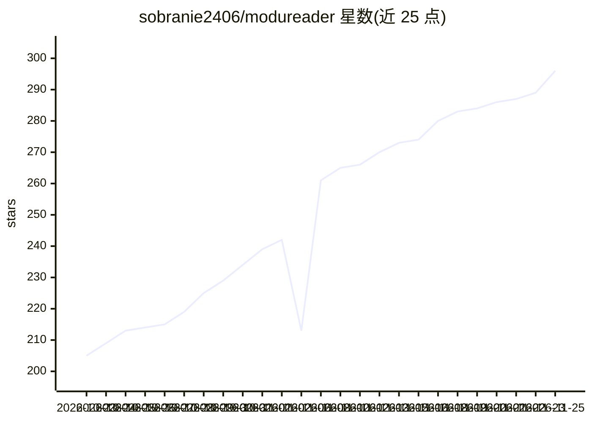

# sobranie2406/modureader

⭐ 296 · Dart · NOASSERTION · 推送 2026-11-23 · [GitHub](https://github.com/sobranie2406/modureader) · [官网](https://github.com/sobranie2406/modureader/releases/latest) · 个人维护 · 中文 README

**开源跨平台电子书/PDF 阅读器，带 OCR、翻译、听书与 AI 阅读**

基于 Flutter 开发的电子书与 PDF 阅读器，覆盖 Android、iOS、macOS、Windows、Linux 与鸿蒙。核心功能包括多格式书库管理（EPUB/PDF/MOBI 等 8 种格式）、自由排版、扫描书重排与原页对照、逐段翻译、听书、高亮笔记、阅读记录及 WebDAV/S3 跨设备同步。AI 部分：离线 OCR 模型在设备上运行、接入用户自有 AI 服务进行选文解释/章节总结/思维导图，TTS 支持系统朗读、Edge TTS、小米 MiMo、OpenAI 兼容服务与 DashScope。本地阅读无需 AI 账号，插件需审核上架并校验签名。

## 筛选速览

| 维度 | 判定 | 备注 |
|---|---|---|
| AI 角色 | `ai-enhanced` | 去掉 AI 部分产品仍成立 |
| 许可风险 | `none` | NOASSERTION |
| 部署形态 | `None` |  |
| 模型依赖 | — | README 未给出锁定关系 |
| 硬件要求 | — | 无带数字的原话,不猜 |
| 安装摩擦 | `low` | 无编译、无系统依赖或容器化 |
| 成熟度 | — | 结构信号不足 |

## 能力要点

- 轻量 OCR 模型设备端运行，扫描书离线转可排版文字
- 听书支持 Edge TTS、小米 MiMo、OpenAI 兼容服务与 DashScope
- 接入自有 AI 服务：解释选文、总结章节、生成思维导图
- 通过自建 WebDAV 或 S3 兼容存储跨设备同步书籍与笔记

## 适用场景

- 在手机或桌面端统一管理多格式电子书书库
- 扫描版 PDF 离线 OCR 后重排阅读并做标注笔记
- 阅读外文或文言书籍时逐段翻译对照
- 用自有 TTS 和 AI 服务听书并追问书中内容

## 场景标签

`OCR` `语音合成` `文档解析` · 领域:内容生成

## 证据(README 行号)

> L7:  开源、跨平台的阅读器。整理书库，专注阅读，用标注、翻译、听书和 AI 读懂每一本书。
> L46: 把扫描页变成可排版、可选词的文字，继续翻译、标注、记笔记。轻量 OCR 模型在设备上运行，下载后即可离线使用。
> L100: 解释选文、总结章节、梳理论证、追踪人物，或生成思维导图。接入自己的 AI 服务，自定义阅读技能，围绕书中内容继续追问。

## 星数曲线

2026-10-23 205 → 2026-11-25 296（+91）

---
*卡片 v1 · prompt 1.4 · 生成 2026-11-25 · 置信度 high · 依据 README sha `89c79a89e857` · [字段定义](../../DATASET.md)*
