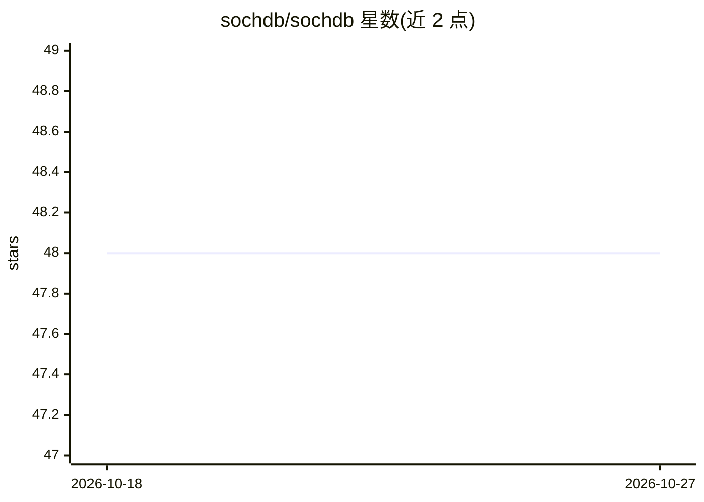

# sochdb/sochdb

⭐ 48 · Rust · AGPL-3.0 · 推送 2026-09-19 · [GitHub](https://github.com/sochdb/sochdb) · [官网](https://sochdb.dev) · 组织维护

**面向 AI agent 的嵌入式 ACID 向量数据库，单引擎整合 SQL/向量/图记忆**

以 Rust 编写的嵌入式单文件数据库，面向需要为 LLM/agent 组装上下文的开发者：在同一个 ACID 列式存储引擎上提供 SQL-92 查询（支持 JOIN 与多方言归一化）、HNSW+BM25 混合检索（RRF 融合）、双时态知识图覆盖层，以及带 token 预算的 Context Query Builder（TOON 紧凑输出）。提供 Rust/Python/Node.js/Go SDK（FFI 嵌入与 Unix socket IPC 两种模式）及带 gRPC 服务端的 Docker 镜像，另含策略钩子、工具路由、命名空间隔离等 agent 原语；async tokio 运行时为可选。限制：无内置 agent 运行时，SDK 分仓维护、各自独立发版。

## 筛选速览

| 维度 | 判定 | 备注 |
|---|---|---|
| AI 角色 | `ai-ecosystem` | LLM/agent 周边工具 |
| 许可风险 | `viral` | AGPL-3.0 |
| 部署形态 | `self-host` | docker 或自建部署 |
| 模型依赖 | — | README 未给出锁定关系 |
| 硬件要求 | — | 无带数字的原话,不猜 |
| 安装摩擦 | `low` | 无编译、无系统依赖或容器化 |
| 成熟度 | — | 结构信号不足 |

## 能力要点

- 单引擎整合 SQL-92、HNSW 向量+BM25 混合检索与双时态知识图
- Context Query Builder 在 token 预算内融合多源上下文，输出 TOON 紧凑格式
- MVCC+WAL+SSI 的完整 ACID 事务与列式存储
- Rust/Python/Node.js/Go 四语言 SDK，FFI 嵌入与 IPC 两种模式，附 gRPC Docker 镜像

## 适用场景

- 替代关系库+向量库+缓存的组合，为 agent 提供单文件记忆存储
- 在 token 预算内为 LLM 组装系统提示、历史与检索结果的上下文
- 跨会话维护实体关系图与因果链式对话记忆
- 嵌入式/离线部署场景下做混合向量+关键词检索

## 场景标签

`向量数据库` `知识图谱` `Agent 记忆` · 领域:Agent 开发

## 证据(README 行号)

> L5: SochDB is an **embedded, AI-native database** that puts your structured data, embeddings, and agent memory in **one 
> L7: Instead of wiring a relational DB + a vector DB + a cache + prompt-packing glue, you get it all on one ACID, columna
> L79: 🧠 **Context Query Builder** — Assemble system + user + history + retrieval under a token budget

## 星数曲线

2026-10-18 48 → 2026-10-27 48（+0）

---
*卡片 v1 · prompt 1.4 · 生成 2026-10-25 · 置信度 high · 依据 README sha `0527fd55ec22` · [字段定义](../../DATASET.md)*
