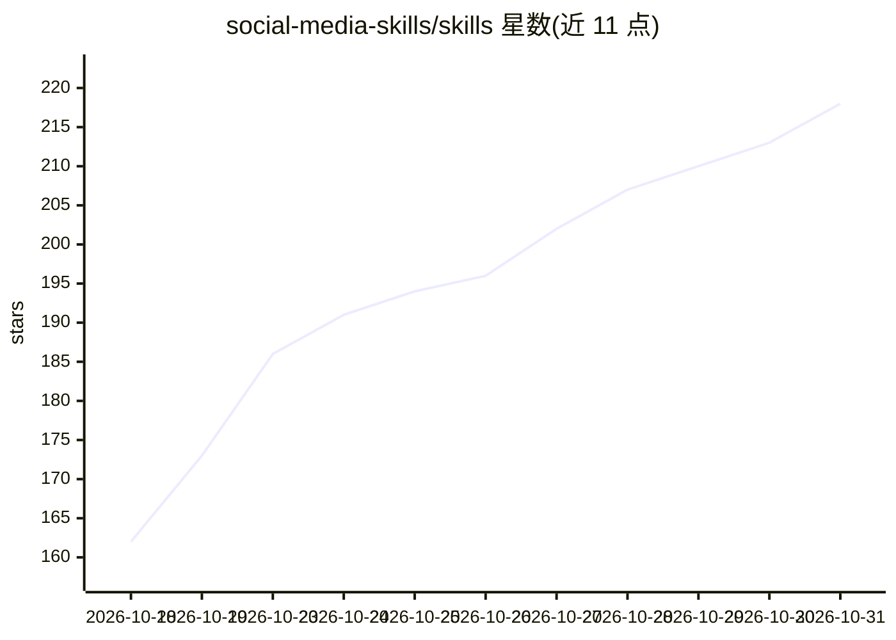

# social-media-skills/skills

⭐ 218 · Shell · MIT · 推送 2026-10-15 · [GitHub](https://github.com/social-media-skills/skills) · [官网](https://social-media-skills.com) · 组织维护

**面向 AI agent 的 106 个社交媒体运营技能集（SKILL.md 格式）**

以 Agent Skills 约定（SKILL.md + frontmatter）组织的技能集合：106 个技能覆盖品牌档案、内容日历、平台文案写作（LinkedIn/X/TikTok 等 9 平台）、视觉设计、AI 媒体工具路由（图像/视频/语音）与增长分析，技能间可相互路由形成从品牌建立到发布的链路。兼容 Claude Code、Cursor、OpenClaw、Hermes 等 40+ agent 框架，通过 npx CLI、Claude Code 插件市场、手动复制或 claude.ai 上传 topic pack 安装；MIT 许可。

## 筛选速览

| 维度 | 判定 | 备注 |
|---|---|---|
| AI 角色 | `ai-knowledge` | 知识聚合/清单类 |
| 许可风险 | `permissive` | MIT |
| 部署形态 | `library` | 以包/库形式分发 |
| 模型依赖 | locked-api |  |
| 硬件要求 | — | 无带数字的原话,不猜 |
| 安装摩擦 | `low` | 无编译、无系统依赖或容器化 |
| 成熟度 | — | 结构信号不足 |

## 能力要点

- 106 个技能按 14 个主题组织，覆盖策略/写作/视频/设计/增长/发布/分析
- 技能间自动路由：品牌档案→内容规划→创作→排期发布
- 兼容 Claude Code、Cursor、OpenClaw、Hermes 等 40+ agent 的 SKILL.md 标准
- 提供 npx CLI、插件市场、手动复制与 claude.ai 上传四种安装途径

## 适用场景

- 给 Claude Code 等 coding agent 加装社交媒体运营能力
- 让 agent 基于品牌档案产出平台原生文案与内容日历
- 在 claude.ai 网页端通过 topic pack 使用成套技能

## 场景标签

`AI 写作` `图像生成` · 领域:内容生成

## 证据(README 行号)

> L111: **Any other agent framework** — skills are plain Markdown following the
> L112: Agent Skills convention (`SKILL.md` + frontmatter `name` /
> L113: `description`), the same ecosystem used by Claude Code, Cursor, Codex CLI, OpenClaw, Hermes,

## 星数曲线

2026-10-18 162 → 2026-10-31 218（+56）

---
*卡片 v1 · prompt 1.4 · 生成 2026-10-23 · 置信度 high · 依据 README sha `2a092fb0ee92` · [字段定义](../../DATASET.md)*
