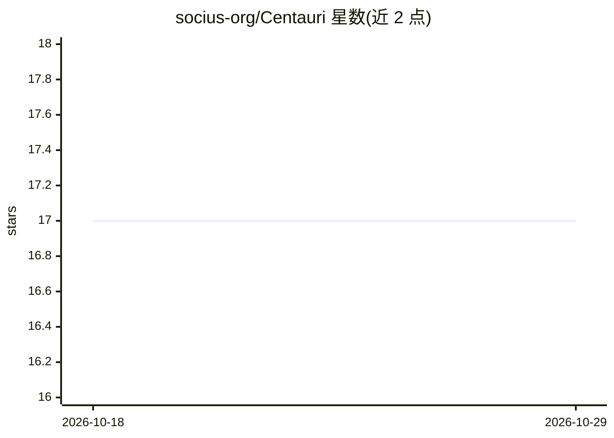

# socius-org/Centauri

⭐ 17 · Python · MIT · 推送 2026-10-13 · [GitHub](https://github.com/socius-org/Centauri) · [官网](https://socius.org/research/small-foundation-models-of-human-cognition/) · 组织维护

**训练心理学行为预测小型基础模型的研究代码库**

用于在 Psych-101 基准上训练和评测人类认知与行为小型基础模型的研究代码库：以 LoRA 微调 Llama、Qwen、SmolLM、OLMo 四个基础模型家族（0.1B–14B）预测 160 个心理学实验中的人类选择，并按 adapter 秩与训练数据比例做网格实验。研究问题为模型可缩至多小及其学到的内容，支持 4-bit QLoRA、OOD 评测与 prompt 通道消融，发布 117 个 LoRA adapter 与数据集，MIT 许可。

## 筛选速览

| 维度 | 判定 | 备注 |
|---|---|---|
| AI 角色 | `ai-native` | 本体是模型或模型工具 |
| 许可风险 | `permissive` | MIT |
| 部署形态 | `library` | 以包/库形式分发 |
| 模型依赖 | — | README 未给出锁定关系 |
| 硬件要求 | — | 无带数字的原话,不猜 |
| 安装摩擦 | `low` | 无编译、无系统依赖或容器化 |
| 成熟度 | — | 结构信号不足 |

## 能力要点

- LoRA 微调四个基础模型家族（135M–14B）预测 Psych-101 人类选择
- 实验网格覆盖秩扫 {4–64} 与数据比例 {6.25–100%} 消融
- 发布 117 个 LoRA adapter 及 Psych-101/Psych-201 数据集
- 提供一键复现图表与 LaTeX 表格的脚本

## 适用场景

- 心理学实验中复现小型行为预测模型的训练与评测
- 研究模型规模、LoRA 秩与数据量对行为预测的影响
- 在留出任务上做分布外行为预测评测

## 场景标签

`微调` `模型评测` · 领域:评测与运维

## 证据(README 行号)

> L11: **Centauri** is a research codebase for training and evaluating small foundation models of human
> L12: cognition and behaviour. It fine-tunes small pretrained LLMs with LoRA to predict human choices on
> L21: We LoRA-fine-tune four families of base models (Llama, Qwen, SmolLM, OLMo) — **135M to 14B**

## 星数曲线

2026-10-18 17 → 2026-10-29 17（+0）

---
*卡片 v1 · prompt 1.4 · 生成 2026-10-29 · 置信度 mid · 依据 README sha `13b48044879c` · [字段定义](../../DATASET.md)*
