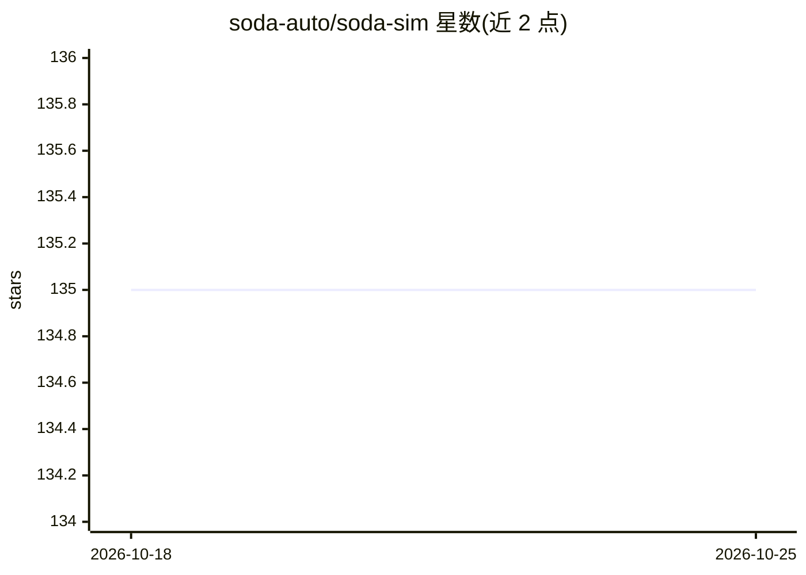

# soda-auto/soda-sim

⭐ 135 · C++ · NOASSERTION · 推送 2026-02-20 · [GitHub](https://github.com/soda-auto/soda-sim) · [官网](https://soda.auto/products/sim/) · 组织维护

**面向自动驾驶/ADAS 开发验证的车辆仿真器（UnrealEngine 插件）**

SODA.AUTO 团队开发的车辆与机器人仿真器，以 UnrealEngine 5.4 插件形式提供，支持 Windows 与 Linux。它在传感器、车辆系统、电子控制单元等原子组件层面模拟车辆，用于 AD/ADAS 的开发与整车功能的虚拟验证。配套 SODA Validation Library（含 AI 场景生成器与场景混合器，需申请访问）。生态包含 ROS2 支持包、自定义 ROS 消息、HTTP 远程控制 Python 客户端等仓库。安装方式为克隆到 UE 插件目录（含 LFS 文件）。版权归 SODA.AUTO UK LTD，许可证详见 LICENSE 文件。

## 筛选速览

| 维度 | 判定 | 备注 |
|---|---|---|
| AI 角色 | `ai-ecosystem` | LLM/agent 周边工具 |
| 许可风险 | `none` | NOASSERTION |
| 部署形态 | `None` |  |
| 模型依赖 | — | README 未给出锁定关系 |
| 硬件要求 | — | 无带数字的原话,不猜 |
| 安装摩擦 | `low` | 无编译、无系统依赖或容器化 |
| 成熟度 | — | 结构信号不足 |

## 能力要点

- 以传感器/车辆系统/ECU 原子组件层面仿真车辆
- 作为 UnrealEngine 5.4 插件运行，支持 Windows/Linux
- 生态含 ROS2 支持、自定义 ROS 消息与 HTTP 远程控制客户端
- 配套 SODA Validation Library（AI 场景生成/混合，需申请访问）

## 适用场景

- 在虚拟环境中开发与验证 AD/ADAS 功能
- 为整车功能做仿真验证与认证前的测试
- 结合 ROS2 搭建自动驾驶仿真与测试流程

## 场景标签

 · 领域:自动驾驶/仿真

## 证据(README 行号)

> L3: SODA.Sim is designed for seamless software validation of any vehicle, covering the entire process from initial conce
> L5: By simulating vehicles at the level of atomic components, such as sensors, vehicle systems, and electronic control u
> L22: This repository is plugin for UnrealEngine. You can clone this repo to the UnrealEngine's plugins folder or to the 

## 星数曲线

2026-10-18 135 → 2026-10-25 135（+0）

---
*卡片 v1 · prompt 1.4 · 生成 2026-10-22 · 置信度 mid · 依据 README sha `6ec1807c48ae` · [字段定义](../../DATASET.md)*
