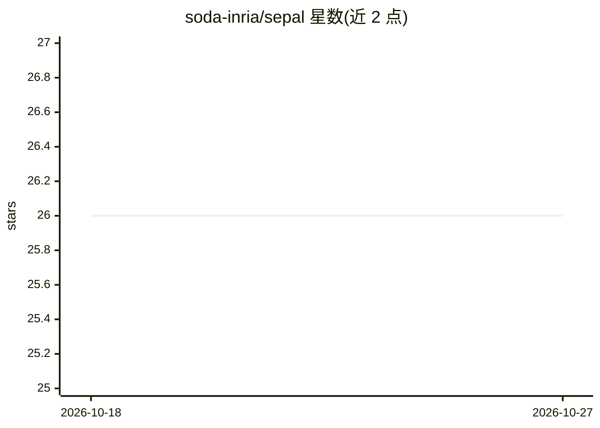

# soda-inria/sepal

⭐ 26 · Python · BSD-3-Clause · 推送 2026-03-17 · [GitHub](https://github.com/soda-inria/sepal)

**知识图谱上生成下游机器学习特征嵌入的方法实现**

SEPAL 论文（NeurIPS 2025，Lefebvre 与 Varoquaux）的官方实现：在大规模知识图谱上进行可扩展特征学习，生成实体嵌入供下游回归与分类任务使用；支持百万级实体，并对高度偏斜的度分布具有稳健性。仓库提供 Mini YAGO3 教程 notebook，下游数据集发布在 Hugging Face。方法细节与消融实验见 arXiv 论文，README 未包含安装命令。

## 筛选速览

| 维度 | 判定 | 备注 |
|---|---|---|
| AI 角色 | `ai-native` | 本体是模型或模型工具 |
| 许可风险 | `permissive` | BSD-3-Clause |
| 部署形态 | `None` |  |
| 模型依赖 | — | README 未给出锁定关系 |
| 硬件要求 | — | 无带数字的原话,不猜 |
| 安装摩擦 | `low` | 无编译、无系统依赖或容器化 |
| 成熟度 | — | 结构信号不足 |

## 能力要点

- 支持百万级实体的大规模知识图谱
- 对高度偏斜的度分布具有稳健性
- 生成嵌入用于下游回归与分类任务
- 提供 Mini YAGO3 示例 notebook

## 适用场景

- 在大规模知识图谱上为实体生成特征嵌入
- 将嵌入接入下游回归或分类管线
- 复现论文中的实验方法

## 场景标签

`知识图谱` · 领域:知识与检索

## 证据(README 行号)

> L9: This repository contains the implementation of the paper:
> L19: - Produces embeddings for downstream regression and classification tasks

## 星数曲线

2026-10-18 26 → 2026-10-27 26（+0）

---
*卡片 v1 · prompt 1.4 · 生成 2026-10-26 · 置信度 high · 依据 README sha `1f673f7e88e2` · [字段定义](../../DATASET.md)*
