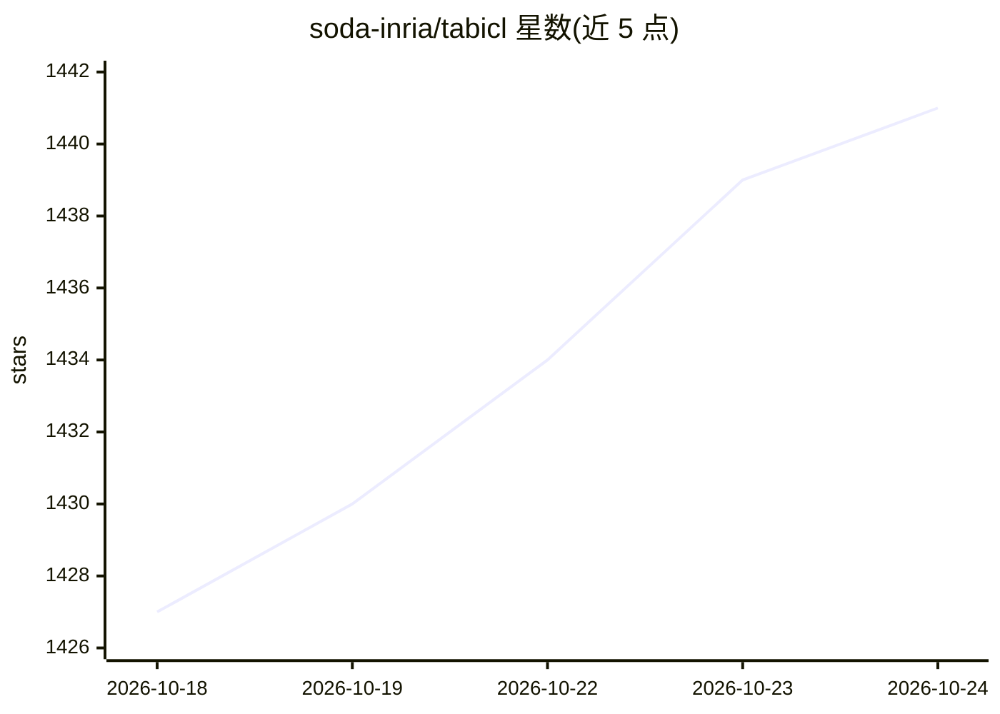

# soda-inria/tabicl

⭐ 1,441 · Python · NOASSERTION · 推送 2026-10-09 · [GitHub](https://github.com/soda-inria/tabicl) · [官网](https://tabicl.readthedocs.io/en/latest/) · 组织维护

**表格数据基础模型：零样本分类/回归/时序预测**

TabICLv2 是开源表格基础模型（ICML 2026），提供 scikit-learn 兼容的 TabICLClassifier/Regressor/Forecaster，通过预训练 Transformer 在单次前向传播中同时完成 fit 与 predict，无需超参调优。支持 KV 缓存加速重复推理、CPU/磁盘卸载扩展至更大数据集、SHAP 可解释性、单数据集微调（AdamW、多 GPU）及时序预测；预训练代码与合成数据生成脚本开源。基准覆盖 300–48K 训练样本、约 2–100 列，特征数大幅超出 100 可能性能下降。以 pip 包形式提供，H100 上 5 万样本/100 特征数据集 fit+predict 低于 10 秒。

## 筛选速览

| 维度 | 判定 | 备注 |
|---|---|---|
| AI 角色 | `ai-native` | 本体是模型或模型工具 |
| 许可风险 | `none` | NOASSERTION |
| 部署形态 | `library` | 以包/库形式分发 |
| 模型依赖 | — | README 未给出锁定关系 |
| 硬件要求 | — | 无带数字的原话,不猜 |
| 安装摩擦 | `low` | 无编译、无系统依赖或容器化 |
| 成熟度 | — | 结构信号不足 |

## 能力要点

- 单次前向传播完成 fit 与 predict，无需超参调优
- scikit-learn 兼容接口，pip 安装
- KV 缓存加速同一训练数据的重复推理
- 微调、SHAP 解释、时序预测、预训练代码均可选安装

## 适用场景

- 跳过调参直接对表格数据做分类或回归
- 在单个重要数据集上快速微调模型
- 零样本时序预测与模型解释分析

## 场景标签

`微调` `模型训练` · 领域:训练与推理

## 证据(README 行号)

> L7: This repository is the official implementation of **TabICLv2** (ICML 2026)
> L264: TabICL is a tabular foundation model (like TabPFN).
> L267: `y_pred = model(X_train, y_train, X_test)` (this is called inside `predict()`).

## 星数曲线

2026-10-18 1,427 → 2026-10-24 1,441（+14）

---
*卡片 v1 · prompt 1.4 · 生成 2026-10-21 · 置信度 high · 依据 README sha `0066369e2849` · [字段定义](../../DATASET.md)*
