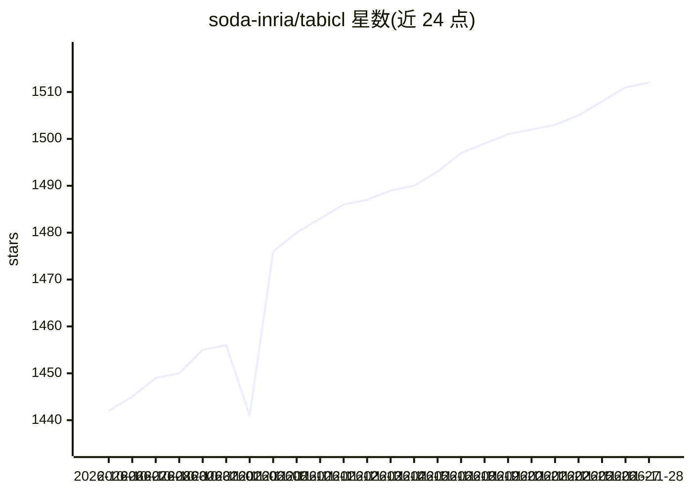

# soda-inria/tabicl

⭐ 1,512 · Python · NOASSERTION · 推送 2026-11-26 · [GitHub](https://github.com/soda-inria/tabicl) · [官网](https://tabicl.readthedocs.io/en/latest/) · 组织维护

**面向数据科学者的开源表格基础模型：零样本分类/回归/预测**

TabICLv2/TabICL 的官方实现（ICML 2025/2026 论文），是表格基础模型，通过在数百万合成数据集上预训练的 Transformer 进行零样本 in-context learning，单次前向传播完成 fit 与 predict。提供 TabICLClassifier 与 TabICLRegressor，符合 scikit-learn 接口，支持 KV 缓存加速重复推理、CPU/磁盘 offloading 扩展到 50 万样本级数据，另提供时间序列预测、SHAP 解释、单数据集微调（多 GPU）及完整预训练代码。基准测试中无需调参；大数据集推荐 GPU。

## 筛选速览

| 维度 | 判定 | 备注 |
|---|---|---|
| AI 角色 | `ai-native` | 本体是模型或模型工具 |
| 许可风险 | `none` | NOASSERTION |
| 部署形态 | `library` | 以包/库形式分发 |
| 模型依赖 | — | README 未给出锁定关系 |
| 硬件要求 | — | 无带数字的原话,不猜 |
| 安装摩擦 | `low` | 无编译、无系统依赖或容器化 |
| 成熟度 | — | 结构信号不足 |

## 能力要点

- 零样本表格分类与回归，scikit-learn 兼容，无需超参数调优
- 预训练代码与合成数据生成全部开源（含三阶段训练脚本）
- 支持时间序列预测（TabICLForecaster）与 SHAP 解释集成
- KV 缓存加速重复推理；CPU/磁盘 offloading 支持更大规模数据

## 适用场景

- 替代传统调参流程，对中小规模表格数据做零样本分类/回归
- 对时间序列做零样本预测
- 基于自己的数据集微调或从头预训练表格基础模型
- 用 SHAP 解释表格模型预测结果

## 场景标签

`微调` `模型训练` `数据分析` · 领域:效率与自动化

## 证据(README 行号)

> L5: # TabICLv2: An open tabular foundation model
> L12: TabICLv2 is a competitive model for tabular classification and regression
> L22: forward pass through a pre-trained transformer model.

## 星数曲线

2026-10-26 1,442 → 2026-11-28 1,512（+70）

---
*卡片 v1 · prompt 1.4 · 生成 2026-11-27 · 置信度 high · 依据 README sha `7dffa219968a` · [字段定义](../../DATASET.md)*
