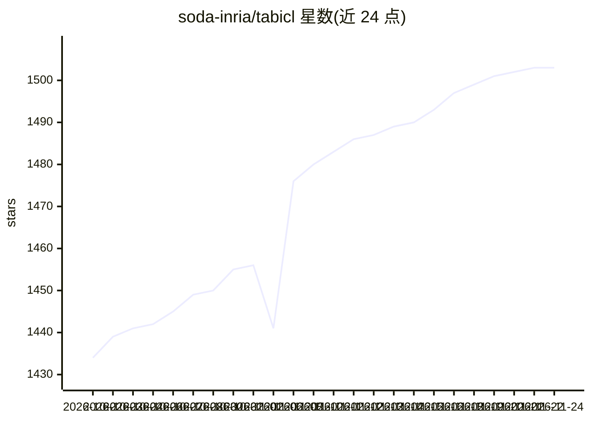

# soda-inria/tabicl

⭐ 1,505 · Python · NOASSERTION · 推送 2026-11-20 · [GitHub](https://github.com/soda-inria/tabicl) · [官网](https://tabicl.readthedocs.io/en/latest/) · 组织维护

**表格数据基础模型库：零微调做表格分类、回归与预测**

TabICL/TabICLv2 的官方实现，是面向表格数据的基础模型，通过预训练 Transformer 的单次前向传播（in-context learning）完成 fit 与 predict，支持零样本分类、回归和时间序列预测。以 scikit-learn 兼容的 Python 包发布，提供 KV 缓存加速重复推理、SHAP 可解释性集成、单数据集微调（多 GPU torchrun）与含合成数据生成的完整预训练流程，并附最小架构实现 nanotabicl。较大数据集推荐 GPU，可经 CPU/磁盘 offloading 扩展。

## 筛选速览

| 维度 | 判定 | 备注 |
|---|---|---|
| AI 角色 | `ai-native` | 本体是模型或模型工具 |
| 许可风险 | `none` | NOASSERTION |
| 部署形态 | `library` | 以包/库形式分发 |
| 模型依赖 | — | README 未给出锁定关系 |
| 硬件要求 | — | 无带数字的原话,不猜 |
| 安装摩擦 | `low` | 无编译、无系统依赖或容器化 |
| 成熟度 | — | 结构信号不足 |

## 能力要点

- 单次前向传播完成 fit 与 predict，支持 KV 缓存加速重复推理
- 零样本分类/回归，另有时间序列预测 TabICLForecaster
- 提供完整预训练代码（合成数据在线生成）与单数据集微调（多 GPU）
- scikit-learn 兼容，pip 安装，集成 SHAP 解释

## 适用场景

- 对表格数据做零样本分类或回归而无需调参流程
- 对时间序列做零样本预测
- 在重要下游数据集上花几分钟微调专用模型
- 研究表格基础模型的预训练流程与架构

## 场景标签

`微调` `模型训练` · 领域:训练与推理

## 证据(README 行号)

> L5: # TabICLv2: An open tabular foundation model
> L12: TabICLv2 is a competitive model for tabular classification and regression
> L22: forward pass through a pre-trained transformer model.

## 星数曲线

2026-10-22 1,434 → 2026-11-24 1,503（+69）

---
*卡片 v1 · prompt 1.4 · 生成 2026-11-23 · 置信度 high · 依据 README sha `264d974b646a` · [字段定义](../../DATASET.md)*
