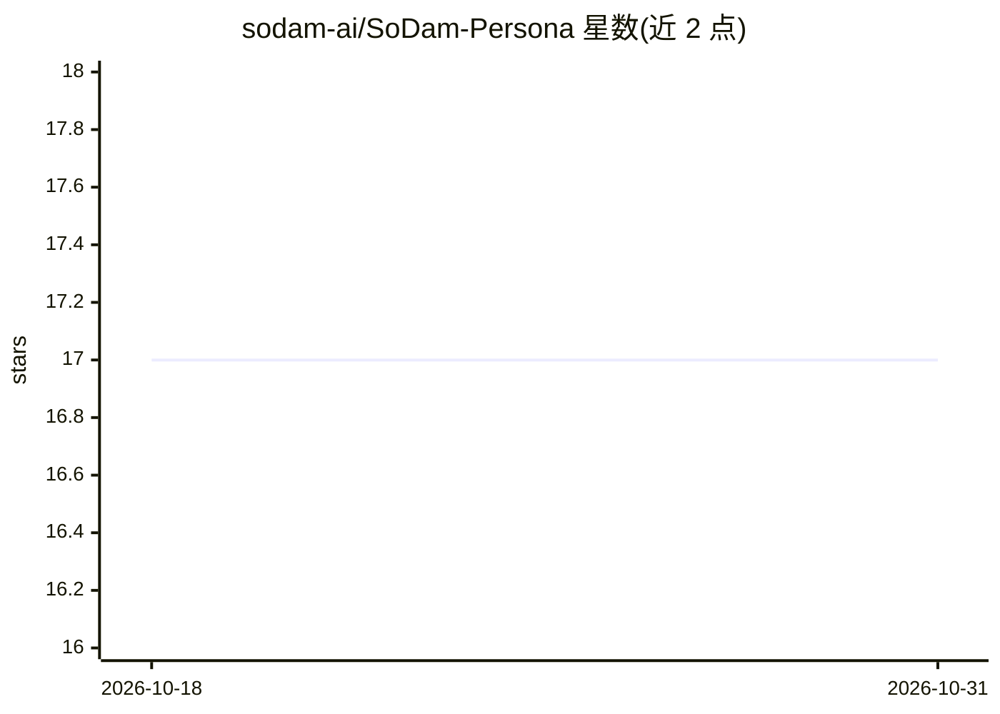

# sodam-ai/SoDam-Persona

⭐ 17 · JavaScript · Apache-2.0 · 推送 2026-08-31 · [GitHub](https://github.com/sodam-ai/SoDam-Persona) · 组织维护 · 中文 README

**给 Claude Code 注入 15 位专家视角人格的插件**

面向 Anthropic Claude Code 的插件，本体不是独立 AI，而是通过 2 个常驻 hook 与 9 个条件加载 skill，为对话叠加'慎重细致的韩语开发伙伴'规则集：请求按 L0-L3 四级强度分类，响应前自动检索 15 个专家视角中相关的 3-5 个；20 个触发词模式（A~T）可升降强度、激活投资/法律/税务/营销 4 类领域专家 skill，其中税务类强制附免责声明；非可逆操作前强制人工确认。支持通过 Claude Code 插件市场或本地仓库安装，提供 persona-create/edit 面试式命令生成新人格。

## 筛选速览

| 维度 | 判定 | 备注 |
|---|---|---|
| AI 角色 | `ai-ecosystem` | LLM/agent 周边工具 |
| 许可风险 | `permissive` | Apache-2.0 |
| 部署形态 | `library` | 以包/库形式分发 |
| 模型依赖 | locked-api |  |
| 硬件要求 | — | 无带数字的原话,不猜 |
| 安装摩擦 | `low` | 无编译、无系统依赖或容器化 |
| 成熟度 | — | 结构信号不足 |

## 能力要点

- 2 个常驻 hook + 9 个条件 skill 的规则注入结构
- L0-L3 四级响应强度与 20 组触发词模式
- 15 个专家视角每次响应前自动检索 3-5 个
- 税务/法律领域回答自动附免责与合规检查，非可逆操作强制确认

## 适用场景

- 让 Claude Code 在韩语开发协作中自动切换专家视角回答
- 投资/法律/税务/营销场景获得带免责声明的深度审查
- 通过面试式命令创建和编辑自定义领域人格

## 场景标签

`提示工程` · 领域:Agent 开发

## 证据(README 行号)

> L7: 이 플러그인 자체는 별도의 AI가 아닙니다. Claude Code가 이미 갖고 있는 대화 능력 위에 "이렇게 판단하고 이렇게 답하라"는 규칙 문서를 자동으로 얹어주는 설정 모음입니다. 항상 켜지는 핵심 규칙(
> L37: |1|Claude Code CLI(터미널에서 쓰는 버전) 또는 Claude Code가 연결된 IDE(코드 편집기) 확장|이 플러그인은 Claude Code "안"에서 동작하는 부가 기능이라, Claude C

## 星数曲线

2026-10-18 17 → 2026-10-31 17（+0）

---
*卡片 v1 · prompt 1.4 · 生成 2026-10-29 · 置信度 mid · 依据 README sha `32c512d0151d` · [字段定义](../../DATASET.md)*
