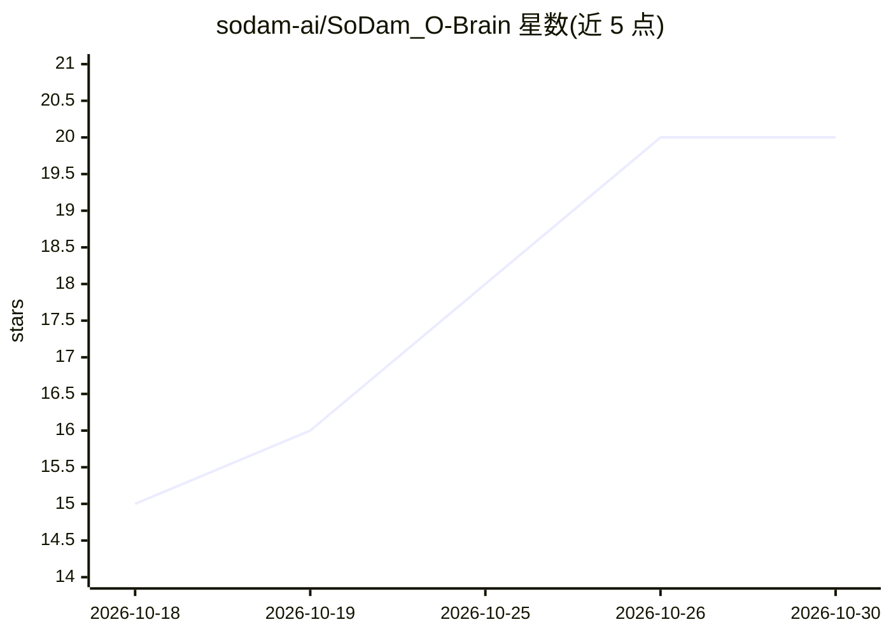

# sodam-ai/SoDam_O-Brain

⭐ 20 · JavaScript · Apache-2.0 · 推送 2026-10-21 · [GitHub](https://github.com/sodam-ai/SoDam_O-Brain) · 组织维护

**给 Claude Code 用户的本地记忆工具：自动存决策、图谱可视化**

面向 Claude Code 使用者的完全本地记忆系统：从对话中自动提取决定、约定、禁止事项并存储到本机 SQLite 数据库，通过关键词（FTS5）+向量（all-MiniLM-L6-v2 本地嵌入）混合检索，以 2D/3D 知识图谱、时间线、列表五种视图呈现。提供 7 个 MCP 工具与 Claude Code 插件集成，支持 6 种格式导出、带预览与回退的导入、自动备份与恢复。记忆数据仅存本机（服务器仅绑定 127.0.0.1），无需 API key。限制：仅支持 Windows 10/11、Node.js 26.7.x，安全过滤不保证拦截所有密码形态。

## 筛选速览

| 维度 | 判定 | 备注 |
|---|---|---|
| AI 角色 | `ai-ecosystem` | LLM/agent 周边工具 |
| 许可风险 | `permissive` | Apache-2.0 |
| 部署形态 | `library` | 以包/库形式分发 |
| 模型依赖 | locked-api |  |
| 硬件要求 | — | 无带数字的原话,不猜 |
| 安装摩擦 | `low` | 无编译、无系统依赖或容器化 |
| 成熟度 | — | 结构信号不足 |

## 能力要点

- FTS5 关键词 + 本地向量嵌入（all-MiniLM-L6-v2）混合检索
- 2D/3D 知识图谱可视化与最短关系路径查找
- 7 个 MCP 工具 + Claude Code 插件（斜杠命令）集成
- 6 种格式导出、带预览与 30 分钟回退的导入、自动备份与 restore

## 适用场景

- 让 Claude Code 记住跨会话的决策与约定并自动回注入新对话
- 以知识图谱查看记忆间的关联并查找两记忆间的关系路径
- 将记忆导出为 Markdown/CSV/HTML 等格式迁移到笔记应用
- 在无云端传输要求下本地管理 AI 对话记忆并定期备份

## 场景标签

`Agent 记忆` `知识图谱` · 领域:Agent 开发

## 证据(README 行号)

> L40: |**MCP 연동**|Claude Code에서 7개 도구로 기억 저장·검색·관계 관리|
> L158: 사용 가능한 MCP 도구: `save_memory`, `search_memory`, `get_memory`, `get_related`, `get_timeline`, `add_relation`, `list_
> L288: 기술 스택: Node.js ES Modules · Express.js v5 · SQLite (better-sqlite3) · sqlite-vec · @huggingface/transformers (all-

## 星数曲线

2026-10-18 15 → 2026-10-30 20（+5）

---
*卡片 v1 · prompt 1.4 · 生成 2026-10-28 · 置信度 high · 依据 README sha `6534af5368d8` · [字段定义](../../DATASET.md)*
