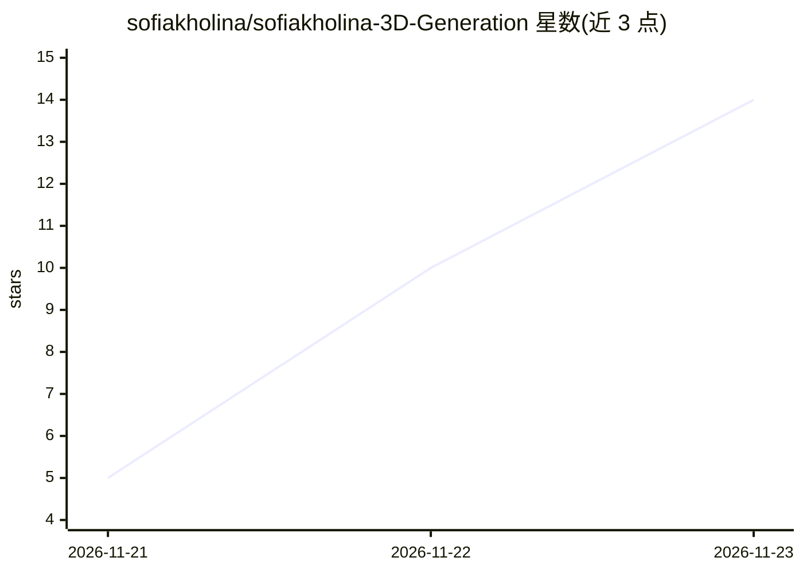

# sofiakholina/sofiakholina-3D-Generation

⭐ 14 · Python · GPL-3.0 · 推送 2026-11-21 · [GitHub](https://github.com/sofiakholina/sofiakholina-3D-Generation) · [官网](https://sofiakholina.taplink.ws/) · 个人维护

**在 ComfyUI 中从单张或多张视图生成无纹理 3D 模型的 3 个 workflow 及安装器**

为 ComfyUI 平台提供的 3D 生成工作流合集：TripoSplat（单照片）、Trellis（单照片）、Pixal_MV（1-4 视图）三套 workflow，输出不带纹理的 3D 网格；配套 Windows 批处理安装器（Install.bat/Check.bat/Uninstall.bat），自动安装节点与模型（约 16 GB）、支持断点续传与卸载。仅支持 Windows、NVIDIA GPU（6 GB+ VRAM）、ComfyUI 0.45+，约需 22 GB 磁盘空间。GPL-3.0 许可，第三方模板与模型遵循各自许可。

## 筛选速览

| 维度 | 判定 | 备注 |
|---|---|---|
| AI 角色 | `ai-native` | 本体是模型或模型工具 |
| 许可风险 | `viral` | GPL-3.0 |
| 部署形态 | `desktop` | 安装包/桌面程序 |
| 模型依赖 | — | README 未给出锁定关系 |
| 硬件要求 | `gpu-8g` | |
| 安装摩擦 | `low` | 无编译、无系统依赖或容器化 |
| 成熟度 | — | 结构信号不足 |

## 能力要点

- 3 套 workflow：TripoSplat/Trellis 单照片生成，Pixal_MV 支持 1-4 视图
- Windows 批处理安装器，支持选择性安装、断点续传与卸载
- Check.bat 校验节点与模型是否齐备
- 配套另一仓库提供任意 3D 模型的纹理化 workflow

## 适用场景

- 从单张照片在 ComfyUI 中生成 3D 网格模型
- 用 1-4 个视图照片生成更完整的多视角模型
- 在 ComfyUI 中一站式安装 3D 生成所需的节点与模型

## 场景标签

 · 领域:3D 生成/创作工具

## 证据(README 行号)

> L59: **Generate an untextured 3D model from one or several views in ComfyUI: 3 workflows + installer.**
> L73: **Windows only, NVIDIA GPU with 6 GB VRAM or more and a current driver, ComfyUI 0.45+. Free disk space: ComfyUI — a

## 星数曲线

2026-11-21 5 → 2026-11-23 14（+9）

---
*卡片 v1 · prompt 1.4 · 生成 2026-11-21 · 置信度 high · 依据 README sha `02d8694c39ba` · [字段定义](../../DATASET.md)*
