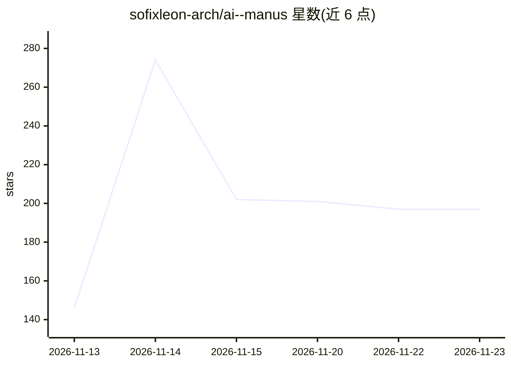

# sofixleon-arch/ai--manus

⭐ 197 · Apache-2.0 · 推送 2026-11-14 · [GitHub](https://github.com/sofixleon-arch/ai--manus) · 个人维护

**面向个人用户的自主 AI Agent：代跑代码与控制浏览器**

README 描述的 Manus 是一个自主 AI agent，可在用户授权下自行编写并执行脚本、控制浏览器完成页面导航、表单填写与信息收集等多步骤任务，定位为家庭、学习与轻办公场景的个人助理，而非企业平台。使用流程为配置默认行为、以小任务测试、逐步扩大自动处理范围。README 未给出任何具体安装命令、技术架构或代码入口，仅提供组件兼容表（最低双核 CPU、4 GB 内存）与大量场景化描述。

## 筛选速览

| 维度 | 判定 | 备注 |
|---|---|---|
| AI 角色 | `ai-native` | 本体是模型或模型工具 |
| 许可风险 | `permissive` | Apache-2.0 |
| 部署形态 | `None` |  |
| 模型依赖 | — | README 未给出锁定关系 |
| 硬件要求 | — | 无带数字的原话,不猜 |
| 安装摩擦 | `low` | 无编译、无系统依赖或容器化 |
| 成熟度 | — | 结构信号不足 |

## 能力要点

- 自主执行代码：agent 自行编写并运行脚本完成任务（L10）
- 浏览器控制：导航网站、填写表单、收集信息（L11）
- 代码与浏览器动作可在同一流程内衔接（L14）
- 兼容表：最低 4 GB 内存、双核 CPU（L37-42）

## 适用场景

- 让学生整理研究笔记、跑快速计算
- 让远程工作者从多个网页收集数据
- 把重复性小任务交给后台 agent 处理

## 场景标签

`AI 助手` `编码 Agent` `浏览器自动化` · 领域:效率与自动化

## 证据(README 行号)

> L10: - **Autonomous Code Execution:** Manus AI agent runs code on its own to complete tasks, so you can focus on decisio
> L18: Manus is an autonomous AI agent designed to run code and control a browser on your behalf. Instead of acting like a
> L22: Manus is not a heavy studio suite or a complex enterprise platform. It is a focused helper built for home, study, a

## 星数曲线

2026-11-13 146 → 2026-11-23 197（+51）

---
*卡片 v1 · prompt 1.4 · 生成 2026-11-17 · 置信度 low · 依据 README sha `4347b4dd3fa7` · [字段定义](../../DATASET.md)*
