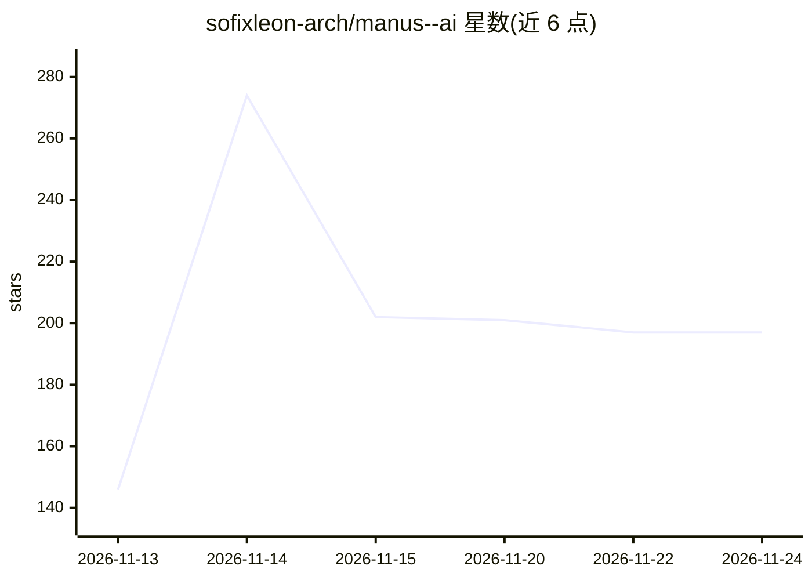

# sofixleon-arch/manus--ai

⭐ 193 · Apache-2.0 · 推送 2026-11-14 · [GitHub](https://github.com/sofixleon-arch/manus--ai) · 个人维护

**自主 AI Agent 系统：代用户执行代码并控制浏览器完成多步任务**

Manus 是一个自主 AI Agent 系统，设计为在用户授权下自主执行代码与控制浏览器：编写并运行脚本、打开网页、填写表单、跨页面收集信息，并以最少监督完成多步骤任务。README 将其定位为面向家庭、学习与轻度办公场景的个人助手，而非企业级平台。README 给出系统兼容性参考表（最低 4GB 内存、双核 CPU）与使用步骤说明，但未提供任何安装命令、依赖说明或代码入口，实际部署方式无法从 README 验证。

## 筛选速览

| 维度 | 判定 | 备注 |
|---|---|---|
| AI 角色 | `ai-native` | 本体是模型或模型工具 |
| 许可风险 | `permissive` | Apache-2.0 |
| 部署形态 | `None` |  |
| 模型依赖 | — | README 未给出锁定关系 |
| 硬件要求 | — | 无带数字的原话,不猜 |
| 安装摩擦 | `low` | 无编译、无系统依赖或容器化 |
| 成熟度 | — | 结构信号不足 |

## 能力要点

- 自主执行代码与控制浏览器，完成多步任务
- 脚本与浏览器操作可在同一流程内衔接
- 面向学习、家庭与轻度办公的小规模任务场景

## 适用场景

- 让 agent 代为完成网页查资料、填表等重复操作
- 整理研究笔记、运行小型脚本与快速实验
- 远程支持中让 agent 检查系统页面、整理诊断步骤

## 场景标签

`AI 助手` `浏览器自动化` · 领域:效率与自动化

## 证据(README 行号)

> L10: - **Autonomous Code Execution:** Manus AI agent runs code on its own to complete tasks, so you can focus on decisio
> L18: Manus is an autonomous AI agent designed to run code and control a browser on your behalf. Instead of acting like a

## 星数曲线

2026-11-13 146 → 2026-11-24 197（+51）

---
*卡片 v1 · prompt 1.4 · 生成 2026-11-17 · 置信度 mid · 依据 README sha `885ad01e4b6b` · [字段定义](../../DATASET.md)*
