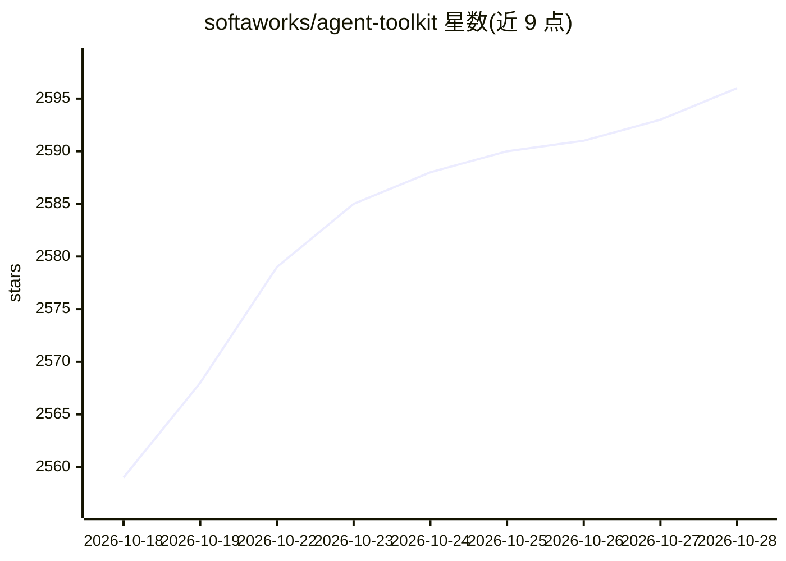

# softaworks/agent-toolkit

⭐ 2,598 · Python · MIT · 推送 2026-03-05 · [GitHub](https://github.com/softaworks/agent-toolkit) · 个人维护

**面向 Claude Code 的 AI 编程 agent 技能合集（40+ 技能/插件）**

个人维护的 AI 编程 agent 技能策展仓库：以 Agent Skills 格式提供 40 余个技能，覆盖开发、文档、规划、职业沟通等类别（如 Codex 代码分析、C4 架构图、QA 测试规划、git commit 等），另含 6 个子 agent 与 8 个斜杠命令。技能以独立插件形式安装，支持 npx skills add 一键安装、Claude Code 插件市场或手动复制；Agents 与 Commands 部分声明仅限 Claude Code CLI 使用，多数技能也可配合 Codex、Cursor、AdaL 等其他编程 agent。

## 筛选速览

| 维度 | 判定 | 备注 |
|---|---|---|
| AI 角色 | `ai-knowledge` | 知识聚合/清单类 |
| 许可风险 | `permissive` | MIT |
| 部署形态 | `library` | 以包/库形式分发 |
| 模型依赖 | — | README 未给出锁定关系 |
| 硬件要求 | — | 无带数字的原话,不猜 |
| 安装摩擦 | `low` | 无编译、无系统依赖或容器化 |
| 成熟度 | — | 结构信号不足 |

## 能力要点

- 40+ 技能按 8 大类组织，每个技能含 SKILL.md 与可选 scripts/references
- 6 个专用子 agent 与 8 个斜杠命令（仅限 Claude Code CLI）
- 支持 npx 一键安装、插件市场与手动复制三种安装方式
- 兼容 Claude Code、Codex、Cursor、AdaL 等多种 AI 编程 agent

## 适用场景

- 给 Claude Code 等 AI 编程 agent 扩展代码分析、文档生成、规划能力
- 生成架构图、README、演讲稿等技术文档
- 通过子 agent 委派 UI/UX 评审、代码模式查找等专项任务

## 场景标签

 · 领域:AI 编程工具/技能集

## 证据(README 行号)

> L3: Opinionated skills shared by @leonardocouy for improving daily work efficiency with Claude Code. Skills are packaged
> L5: Skills follow the Agent Skills format.
> L88: |🤖 AI Tools|codex|Advanced code analysis with GPT-5.2|

## 星数曲线

2026-10-18 2,559 → 2026-10-28 2,596（+37）

---
*卡片 v1 · prompt 1.4 · 生成 2026-10-21 · 置信度 high · 依据 README sha `065d09048f57` · [字段定义](../../DATASET.md)*
