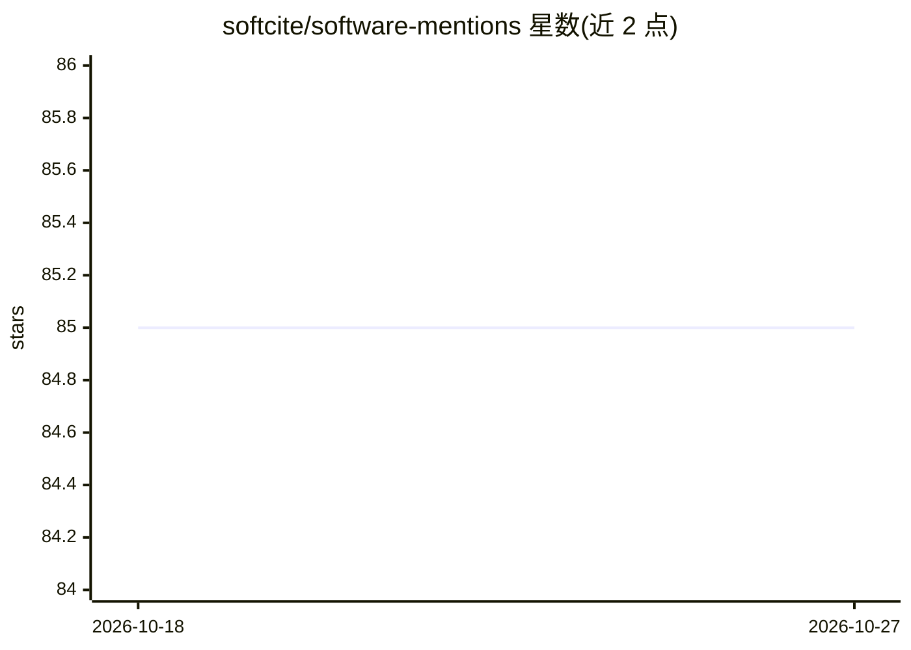

# softcite/software-mentions

⭐ 85 · JavaScript · Apache-2.0 · 推送 2026-09-01 · [GitHub](https://github.com/softcite/software-mentions) · 组织维护

**从学术文献 PDF/XML 中识别软件提及与引用的 GROBID 模块**

面向学术文本挖掘的 GROBID 模块：在学术论文 PDF、出版商 XML 中识别软件提及，可选用 CRF、BiLSTM-CRF、ELMo 或微调 BERT 类模型（SciBERT/LinkBERT），并将提及与参考文献标记关联、经 CrossRef/Unpaywall 消歧，支持 Wikidata 实体链接、PDF 坐标输出及软件使用/创建/共享的分类判定。训练数据为 4,971 篇标注文章的 Softcite 数据集。以 Docker 镜像（约 11GB）方式提供推荐部署，也可用 JDK 1.8+ 从源码构建；深度学习模型需 GPU（仅 Linux 主机支持）。

## 筛选速览

| 维度 | 判定 | 备注 |
|---|---|---|
| AI 角色 | `ai-native` | 本体是模型或模型工具 |
| 许可风险 | `permissive` | Apache-2.0 |
| 部署形态 | `self-host` | docker 或自建部署 |
| 模型依赖 | — | README 未给出锁定关系 |
| 硬件要求 | — | 无带数字的原话,不猜 |
| 安装摩擦 | `low` | 无编译、无系统依赖或容器化 |
| 成熟度 | — | 结构信号不足 |

## 能力要点

- 基于 GROBID 的结构感知提取：跳过图表、公式、参考文献区等无关区域
- 支持 CRF、BiLSTM-CRF、ELMo、微调 SciBERT/LinkBERT 等多种模型
- 软件提及与参考文献关联并经 CrossRef/Unpaywall 消歧，可输出 PDF 坐标
- CRF 模型在单台中等配置服务器上约每秒处理 2 个 PDF

## 适用场景

- 批量挖掘科学文献中的软件使用与引用情况
- 监测科研软件的开放科学情况（如法国 Open Science 监测用例）
- 处理 PLOS 等大规模学术文献集合的软件实体抽取

## 场景标签

`科研工具` `文档解析` · 领域:知识与检索

## 证据(README 行号)

> L7: The goal of this GROBID module is to recognize any software mentions in scholar textual documents, publisher XML and
> L27: As the other GROBID models, the module relies only on state-of-the-art machine learning. The tool can use linear CR

## 星数曲线

2026-10-18 85 → 2026-10-27 85（+0）

---
*卡片 v1 · prompt 1.4 · 生成 2026-10-24 · 置信度 high · 依据 README sha `35e577b22a77` · [字段定义](../../DATASET.md)*
