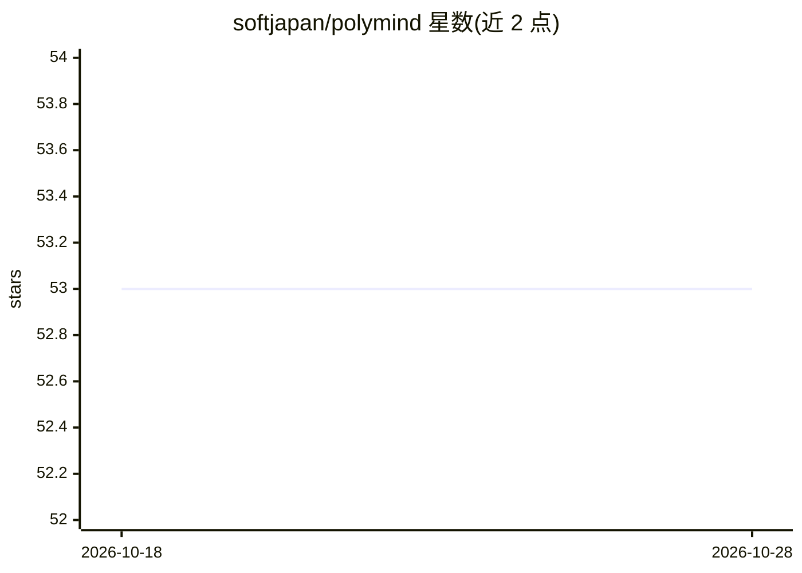

# softjapan/polymind

⭐ 53 · Dart · 推送 2026-09-10 · [GitHub](https://github.com/softjapan/polymind) · [官网](https://softjapan.github.io/polymind/) · 个人维护 · 中文 README

**多提供商 AI 聊天客户端：一个界面切换 OpenAI/Gemini/Claude/Ollama**

基于 Flutter × Riverpod × LangChain Dart 的开源跨平台（iOS/Android/macOS/Web）多提供商 AI 聊天客户端。OpenAI、Google Gemini、Anthropic Claude、Ollama（本地 LLM）统一在 LlmRepository 抽象接口之后，设置界面可随时切换提供商、模型与端点。支持流式响应、图片输入（Vision）、/image 命令调用 OpenAI 图像生成、Markdown 渲染、代码高亮。API 密钥以 flutter_secure_storage 加密保存于端末，聊天记录存于本地 SQLite，无开发者服务器。iOS 版已在 App Store 发布，从源码构建需 Flutter 3.32 以上。

## 筛选速览

| 维度 | 判定 | 备注 |
|---|---|---|
| AI 角色 | `ai-native` | 本体是模型或模型工具 |
| 许可风险 | `permissive` | — |
| 部署形态 | `None` |  |
| 模型依赖 | local-ok | 支持本地模型 |
| 硬件要求 | — | 无带数字的原话,不猜 |
| 安装摩擦 | `low` | 无编译、无系统依赖或容器化 |
| 成熟度 | — | 结构信号不足 |

## 能力要点

- 四个 LLM 提供商统一抽象，设置界面随时切换
- 流式响应、可即时中断（直接取消 StreamSubscription）
- 图片输入（Vision）与 /image 命令图像生成
- API 密钥加密保存于端末、聊天记录本地 SQLite 持久化，无中间服务器

## 适用场景

- 在一个应用中切换使用多家 LLM 提供商与本地 Ollama
- 在移动端进行带图片输入与流式输出的 AI 对话
- 使用不经过第三方服务器的本地优先聊天客户端

## 场景标签

`聊天机器人` `图像生成` · 领域:对话与助手

## 证据(README 行号)

> L3: **OSS なマルチプロバイダー AI チャットクライアント — OpenAI / Gemini / Claude / Ollama を1つのRepositoryインターフェースで統一**
> L15: Flutter × Riverpod × LangChain Dart で構築した、OSSのマルチプロバイダー AI チャットクライアントです。

## 星数曲线

2026-10-18 53 → 2026-10-28 53（+0）

---
*卡片 v1 · prompt 1.4 · 生成 2026-10-24 · 置信度 high · 依据 README sha `50f33500aff6` · [字段定义](../../DATASET.md)*
