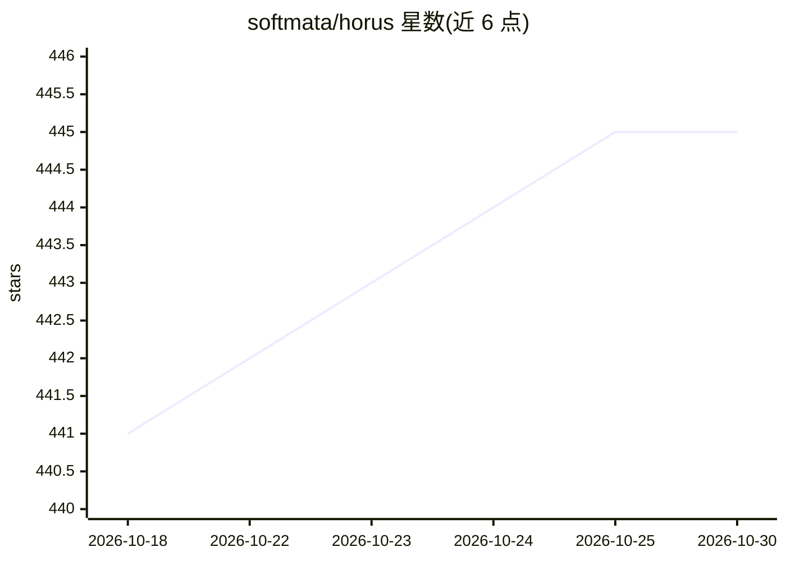

# softmata/horus

⭐ 445 · Rust · Apache-2.0 · 推送 2026-10-26 · [GitHub](https://github.com/softmata/horus) · [官网](https://docs.horusrobotics.dev/) · 组织维护 · 中文 README

**面向机器人与实时系统的分布式中间件，替代 DDS/ROS2**

HORUS 是用共享内存环形缓冲与无锁同步替代 DDS 的实时分布式中间件，提供 Rust、Python、C++ 三语言 API，跨进程 IPC 延迟为 171 纳秒。面向对延迟、确定性与安全有要求的机器人、工业自动化、自动驾驶等开发者。核心机制包括五级执行类调度（RT/线程池/事件/异步 IO/尽力而为）、分级看门狗与安全状态钩子、零拷贝张量管线（帧经共享内存直达 NumPy）、30+ 硬件驱动与 40+ 消息类型。限制：crates.io 无发布渠道，PyPI 上 0.4.x 尚未发布，需从缓存源码构建绑定。

## 筛选速览

| 维度 | 判定 | 备注 |
|---|---|---|
| AI 角色 | `ai-enhanced` | 去掉 AI 部分产品仍成立 |
| 许可风险 | `permissive` | Apache-2.0 |
| 部署形态 | `self-host` | docker 或自建部署 |
| 模型依赖 | — | README 未给出锁定关系 |
| 硬件要求 | — | 无带数字的原话,不猜 |
| 安装摩擦 | `low` | 无编译、无系统依赖或容器化 |
| 成熟度 | — | 结构信号不足 |

## 能力要点

- 共享内存零拷贝 IPC，跨进程 171ns 延迟
- Rust/Python/C++ 共享同一共享内存与话题
- 五级确定性调度（budget/deadline/watchdog）
- 30+ 硬件驱动（Dynamixel、RPLiDAR、RealSense、CAN、EtherCAT）

## 适用场景

- 搭建需要微秒级以下延迟的机器人控制系统
- 在同一进程内跑视觉感知与实时电机控制
- 替代 ROS2/DDS 做跨语言实时节点通信

## 场景标签

 · 领域:机器人/实时中间件

## 证据(README 行号)

> L10: **Real-time distributed middleware for Rust, Python, and C++. Sub-200ns IPC.**
> L74: ## Why HORUS?

## 星数曲线

2026-10-18 441 → 2026-10-30 445（+4）

---
*卡片 v1 · prompt 1.4 · 生成 2026-10-21 · 置信度 mid · 依据 README sha `9706fb1b2809` · [字段定义](../../DATASET.md)*
