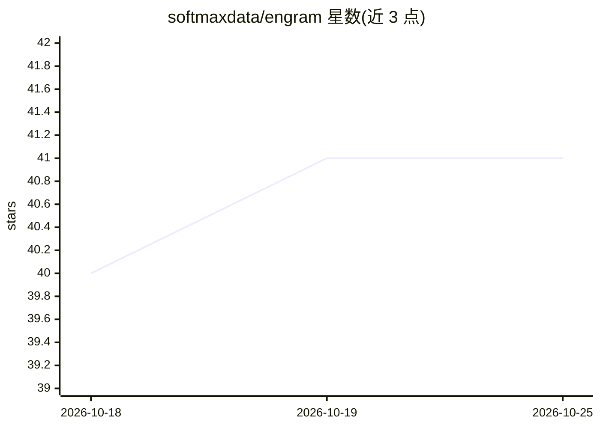

# softmaxdata/engram

⭐ 41 · Python · MIT · 推送 2026-09-30 · [GitHub](https://github.com/softmaxdata/engram) · [官网](https://engram.so) · 组织维护

**面向 AI agent 的可移植上下文数据库服务器**

以服务器形态部署在 agent 与知识图谱之间的上下文存储：将原始文本抽取为原子知识 bullet（8 种类型，带 salience 与使用统计），存入概念图，支持 commit/materialize 两个核心操作，上下文跨会话持久、跨模型迁移。服务器端 Reflector 模型统一处理所有 agent 的输入抽取，另有核心记忆槽（≤512 tokens）、MMR 多样性排序、worked-example 检索、再巩固强化学习与三级生命周期（active→archived→purged）。支持 SQLite/PostgreSQL(pgvector) 存储，提供 pip 包、Docker Compose 与 Python SDK，可接入 LangGraph 等框架。

## 筛选速览

| 维度 | 判定 | 备注 |
|---|---|---|
| AI 角色 | `ai-ecosystem` | LLM/agent 周边工具 |
| 许可风险 | `permissive` | MIT |
| 部署形态 | `desktop` | 安装包/桌面程序 |
| 模型依赖 | — | README 未给出锁定关系 |
| 硬件要求 | — | 无带数字的原话,不猜 |
| 安装摩擦 | `low` | 无编译、无系统依赖或容器化 |
| 成熟度 | — | 结构信号不足 |

## 能力要点

- 原始文本抽取为 8 类原子 bullet 存入概念图，带使用统计与有效 salience 排序
- 服务器端 Reflector 模型统一抽取，所有变更为原子 delta 操作，可审计可回滚
- Mem-α 式核心记忆槽（≤512 tokens）与 Dynamic-Cheatsheet 式 worked-example 检索
- SQLite/PostgreSQL(pgvector) 双后端，支持多 agent 并发（per-context 锁）

## 适用场景

- 为 LangGraph/CrewAI 等 agent 提供跨会话持久记忆
- 让使用不同 LLM 的 agent 共享同一份上下文
- 通过再巩固机制让 agent 上下文随使用改进

## 场景标签

`Agent 记忆` · 领域:Agent 开发

## 证据(README 行号)

> L36: Engram is a **server** that sits between your AI agents and a knowledge graph. Your agents talk to Engram over HTTP
> L157: A complete example showing Engram as the memory backend for a LangGraph agent. The agent recalls context before re

## 星数曲线

2026-10-18 40 → 2026-10-25 41（+1）

---
*卡片 v1 · prompt 1.4 · 生成 2026-10-25 · 置信度 high · 依据 README sha `841df45d7e4d` · [字段定义](../../DATASET.md)*
