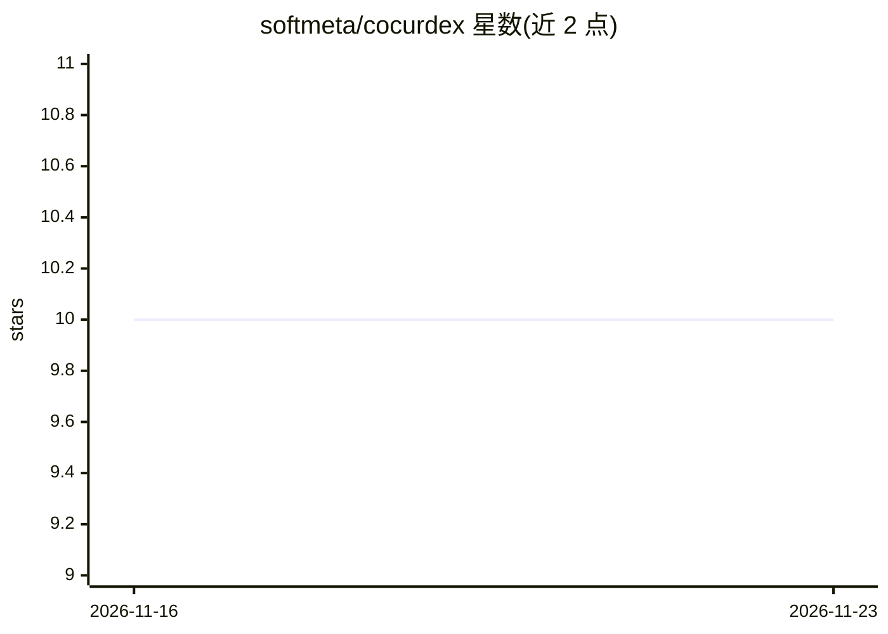

# softmeta/cocurdex

⭐ 10 · TypeScript · NOASSERTION · 推送 2026-11-22 · [GitHub](https://github.com/softmeta/cocurdex) · [官网](https://cocurdex.com) · 组织维护 · 中文 README

**桌面优先的多 AI 编码 Agent 工作区，集中管理各会话**

Electron 桌面应用，将聊天、终端、编辑器与浏览器预览集成在同一个 shell 中，用户可同时运行多个 AI 编码 agent 并追踪各会话状态。本产品不自带模型访问，通过驱动用户已安装的 agent CLI（claude、codex、opencode、grok 等）运行；桌面端启动本地 daemon，无需账号。SQLite 为应用数据唯一存储，外部工具须经 cocurdex CLI 访问。当前为 pre-release，macOS 为主要平台，源码运行需 Node.js 24 与 pnpm。

## 筛选速览

| 维度 | 判定 | 备注 |
|---|---|---|
| AI 角色 | `ai-ecosystem` | LLM/agent 周边工具 |
| 许可风险 | `none` | NOASSERTION |
| 部署形态 | `library` | 以包/库形式分发 |
| 模型依赖 | — | README 未给出锁定关系 |
| 硬件要求 | — | 无带数字的原话,不猜 |
| 安装摩擦 | `low` | 无编译、无系统依赖或容器化 |
| 成熟度 | `idea` | |

## 能力要点

- 聊天/终端/编辑器/浏览器预览集于一屏的多 agent 会话管理
- 驱动既有 agent CLI 运行时，不内置模型访问
- 本地 daemon + SQLite 单一数据源，提供 cocurdex CLI 与可自建 relay

## 适用场景

- 同时运行多个 AI 编码 agent 并跟踪各自会话
- 在单一桌面工作区中完成对话、终端操作与预览
- 自建 relay 实现端到端加密转发的团队协作

## 场景标签

`编码 Agent` · 领域:编码与开发

## 证据(README 行号)

> L5: Cocurdex is a desktop-first multi-agent development workspace. Chat, terminal,
> L48: `codex`, `opencode`, `grok`, and others). Cocurdex drives those runtimes; it
> L49: does not ship model access.

## 星数曲线

2026-11-16 10 → 2026-11-23 10（+0）

---
*卡片 v1 · prompt 1.4 · 生成 2026-11-19 · 置信度 mid · 依据 README sha `3faa3f4c85b5` · [字段定义](../../DATASET.md)*
