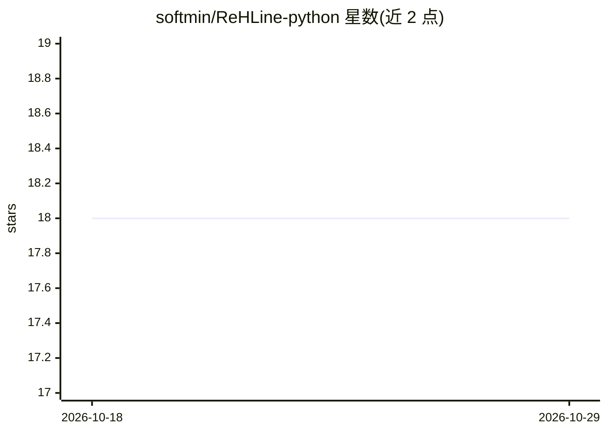

# softmin/ReHLine-python

⭐ 18 · Python · MIT · 推送 2026-09-30 · [GitHub](https://github.com/softmin/ReHLine-python) · [官网](https://rehline.github.io/) · 组织维护

**求解带线性约束 PLQ 损失经验风险最小化的 Python 求解器**

ReHLine 的官方 Python 实现，用 C++ 核心求解大规模经验风险最小化（ERM）问题：支持任意凸分段线性二次（PLQ）损失（hinge、check、Huber 等）与线性等式/不等式约束，每次迭代线性计算复杂度。提供 scikit-learn 兼容的高层估计器（plq_Ridge_Classifier/Regressor，可入 Pipeline 与 GridSearchCV）与低层 API，支持 SciPy 稀疏输入与约束矩阵。通过 pip 安装预编译 wheel 覆盖 Linux/macOS(Apple Silicon)/Windows x86-64，Python 3.10–3.14；源码构建需 C++ 编译器与 Eigen 头文件（自动下载校验）。适用场景包括 SVM、公平机器学习、分位数回归、Huber 回归与 L1 稀疏学习。

## 筛选速览

| 维度 | 判定 | 备注 |
|---|---|---|
| AI 角色 | `ai-native` | 本体是模型或模型工具 |
| 许可风险 | `permissive` | MIT |
| 部署形态 | `library` | 以包/库形式分发 |
| 模型依赖 | — | README 未给出锁定关系 |
| 硬件要求 | — | 无带数字的原话,不猜 |
| 安装摩擦 | `low` | 无编译、无系统依赖或容器化 |
| 成熟度 | — | 结构信号不足 |

## 能力要点

- 支持任意凸 PLQ 损失与线性等式/不等式约束的 ERM 求解
- 提供 scikit-learn 兼容估计器（GridSearchCV、Pipeline 可用）与低层 API
- 接受 CSR/CSC/COO 稀疏 X 与稀疏约束矩阵 A
- 基准测试可用 benchopt 复现（NeurIPS 2023 论文）

## 适用场景

- 训练带公平性约束或非负/单调约束的分类模型
- 做大分位数回归或 Huber 回归等稳健回归任务
- 在 scikit-learn 工作流中替换求解器做带约束的 ERM

## 场景标签

 · 领域:机器学习/凸优化

## 证据(README 行号)

> L12: **ReHLine-Python** is the official Python implementation of ReHLine, a powerful solver for large-scale **empirical 
> L21: - **📊 Scikit-Learn Compatible**: Drop-in replacement with `GridSearchCV`, `Pipeline` support

## 星数曲线

2026-10-18 18 → 2026-10-29 18（+0）

---
*卡片 v1 · prompt 1.4 · 生成 2026-10-29 · 置信度 high · 依据 README sha `17338fa07b4c` · [字段定义](../../DATASET.md)*
