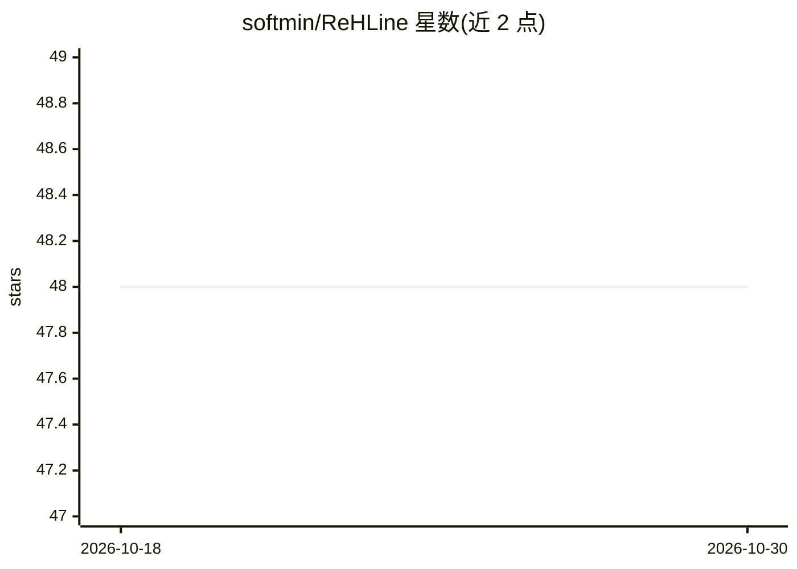

# softmin/ReHLine

⭐ 48 · MIT · 推送 2025-12-16 · [GitHub](https://github.com/softmin/ReHLine) · [官网](https://rehline.github.io/) · 组织维护

**求解带线性约束 PLQ 损失 ERM 问题的优化求解器**

面向大规模经验风险最小化（ERM）问题的求解器：支持任意凸分段线性二次（PLQ）损失（hinge/check/Huber 等）与线性等式/不等式约束，可训练 SVM、公平约束 SVM、分位数回归、Huber 回归、弹性网等模型。所有接口共用同一 C++ 核心，提供 Python（pip）、R（CRAN）与 C++（源码编译）三种接口；Python 接口兼容 scikit-learn 工作流。算法具有可证收敛保证，每轮迭代计算复杂度为线性，出自 NeurIPS 2023 论文。

## 筛选速览

| 维度 | 判定 | 备注 |
|---|---|---|
| AI 角色 | `ai-ecosystem` | LLM/agent 周边工具 |
| 许可风险 | `permissive` | MIT |
| 部署形态 | `library` | 以包/库形式分发 |
| 模型依赖 | — | README 未给出锁定关系 |
| 硬件要求 | — | 无带数字的原话,不猜 |
| 安装摩擦 | `low` | 无编译、无系统依赖或容器化 |
| 成熟度 | — | 结构信号不足 |

## 能力要点

- 支持任意凸 PLQ 损失与线性约束的自定义组合
- Python/R/C++ 三接口共用同一 C++ 核心
- Python 接口兼容 scikit-learn（GridSearchCV/Pipeline）
- 基准结果可通过 benchopt 复现

## 适用场景

- 训练带公平性约束的 SVM 做偏见感知决策
- 在含离群点或噪声的数据上做 Huber 回归/分位数回归
- 在高维数据上训练弹性网做特征选择

## 场景标签

 · 领域:机器学习/优化求解器

## 证据(README 行号)

> L10: **ReHLine** is a powerful solver for large-scale **empirical risk minimization (ERM) problems** with **convex piece
> L24: > **💡 Beyond Pre-built Losses and Constraints**: ReHLine is a **general-purpose solver** that can optimize **any co

## 星数曲线

2026-10-18 48 → 2026-10-30 48（+0）

---
*卡片 v1 · prompt 1.4 · 生成 2026-10-25 · 置信度 high · 依据 README sha `00d033a99082` · [字段定义](../../DATASET.md)*
