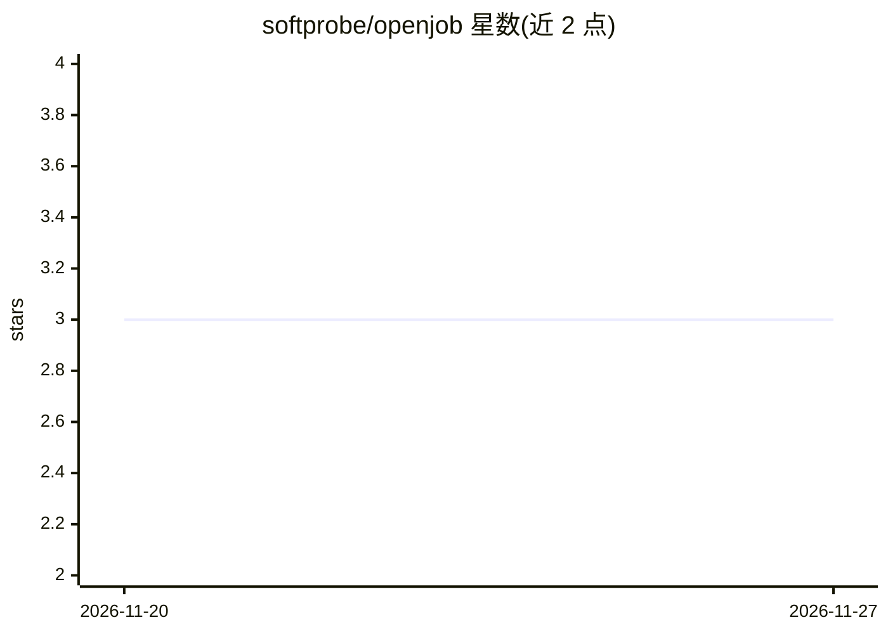

# softprobe/openjob

⭐ 3 · Python · MIT · 推送 2026-11-26 · [GitHub](https://github.com/softprobe/openjob) · [官网](https://openjob.softprobe.ai) · 组织维护

**供 AI agent 读取的公开职位数据库与招聘板**

OpenJob 是一个面向 AI agent 的公开职位数据库：职位、人才档案与公司页以 Markdown 文件存于 GitHub 仓库，经 GitHub Pages 发布，每日核对雇主链接。用户无需安装新 agent，将预设提示词粘贴给已有 agent（可读网页即可），agent 通过 REST API、远程 MCP 端点或数据集分片获取数据并自行匹配。发布支持 GitHub PR、匿名 HTTP 或 MCP 三种方式，含 schema 校验、自动合并、60/180 天过期与隐私规则；仓库可 fork 并自托管。

## 筛选速览

| 维度 | 判定 | 备注 |
|---|---|---|
| AI 角色 | `ai-knowledge` | 知识聚合/清单类 |
| 许可风险 | `permissive` | MIT |
| 部署形态 | `None` |  |
| 模型依赖 | — | README 未给出锁定关系 |
| 硬件要求 | — | 无带数字的原话,不猜 |
| 安装摩擦 | `low` | 无编译、无系统依赖或容器化 |
| 成熟度 | — | 结构信号不足 |

## 能力要点

- 远程 MCP 端点与 /api/v1 有界读取，无需账号或 API key
- 完整数据集分片导出（Cloudflare R2）供 agent 自行排名
- 三种发布途径：GitHub PR、匿名 HTTP、托管 MCP
- MIT（代码）+ CC BY 4.0（帖子与档案）的许可划分

## 适用场景

- 把简历粘贴给现有 agent，让它检索并匹配职位
- 通过提示词让 agent 代为发布职位或个人档案
- Fork 仓库自托管一个独立的招聘板

## 场景标签

 · 领域:招聘/求职信息平台

## 证据(README 行号)

> L5: Let your existing agent find you your next job. A public job database for AI agents. Use the agent you already have 
> L21: For complete data, download the dataset manifest at `https://openjob.softprobe.ai/api/data/manifest.json` and its j
> L23: `jobs.json` and `talents.json` are capped feeds from the repository catalog; API-submitted profiles are available t

## 星数曲线

2026-11-20 3 → 2026-11-27 3（+0）

---
*卡片 v1 · prompt 1.4 · 生成 2026-11-21 · 置信度 high · 依据 README sha `e55e1af9a67f` · [字段定义](../../DATASET.md)*
