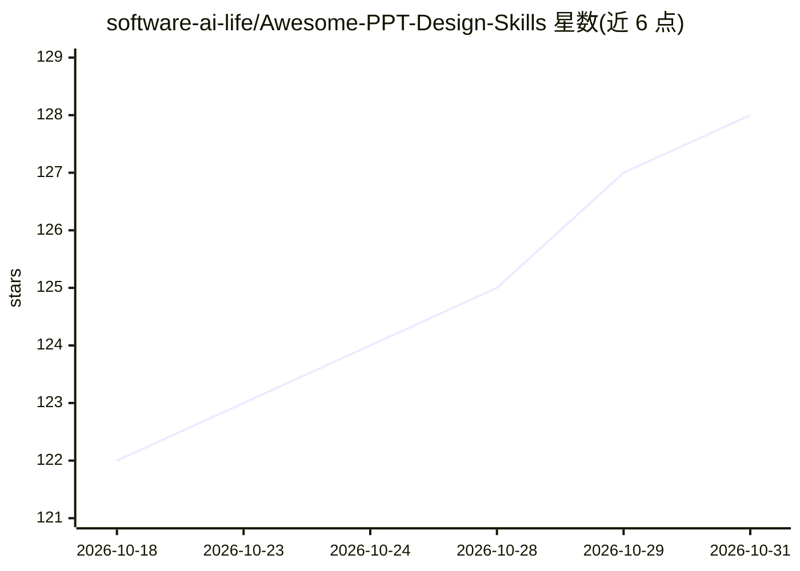

# software-ai-life/Awesome-PPT-Design-Skills

⭐ 128 · HTML · 推送 2026-04-28 · [GitHub](https://github.com/software-ai-life/Awesome-PPT-Design-Skills) · 个人维护 · 中文 README

**给 coding agent 的 PPT 设计技能包：按指定美学生成可编辑简报**

一组 agent-agnostic 的 PPT 设计 skills，包含 6 种风格系统（日式编辑、3D 黏土、未来科技、极简精品、现代插画、日式手绘），每个 skill 提供 SKILL.md、风格系统规则、页型库、ppt-master 集成规则、QA 清单与封面示例。搭配 ppt-master 流程可从 PDF 等来源文件产出 design_spec、SVG 页面并导出为可在 PowerPoint 中编辑的 .pptx。支持繁体中文描述需求，安装方式为复制 skill 文件夹到 agent skills 目录。

## 筛选速览

| 维度 | 判定 | 备注 |
|---|---|---|
| AI 角色 | `ai-knowledge` | 知识聚合/清单类 |
| 许可风险 | `none` | — |
| 部署形态 | `None` |  |
| 模型依赖 | — | README 未给出锁定关系 |
| 硬件要求 | — | 无带数字的原话,不猜 |
| 安装摩擦 | `low` | 无编译、无系统依赖或容器化 |
| 成熟度 | — | 结构信号不足 |

## 能力要点

- 6 种风格系统，每个内含色彩/字体/版面/图表规则与 QA checklist
- ppt-master 流程产出 design_spec、spec_lock、SVG 页面并导出可编辑 .pptx
- 支持繁体中文需求描述与双语简报
- 兼容 Codex、Claude Code、Cursor、OpenCode、OpenClaw、Hermes 等支持本地 skills 的 agent

## 适用场景

- 用一句 prompt 让 coding agent 从 PDF 生成指定风格的简报
- 同一份内容切换不同设计风格产出多套简报
- 需要可在 PowerPoint 中继续编辑而非图片式 PPT 的交付

## 场景标签

 · 领域:办公文档/演示设计

## 证据(README 行号)

> L7: Agent-agnostic PPT design skills for generating polished PowerPoint decks with `ppt-master`.
> L9: 這個 repo 是一組 PPT design skills，重點不是「套模板」，而是讓 agent 在產製簡報時能穩定遵守一套完整的視覺語言：色彩、排版、字體、留白、封面、圖表、QA 與 PPT master 流程。
> L13: 可用於多種支援本地 skills / agent instructions 的 coding agent，例如 Codex、Claude Code、Cursor、OpenCode、OpenClaw、Hermes。不同 agent 

## 星数曲线

2026-10-18 122 → 2026-10-31 128（+6）

---
*卡片 v1 · prompt 1.4 · 生成 2026-10-23 · 置信度 high · 依据 README sha `30f6b1f99f0c` · [字段定义](../../DATASET.md)*
