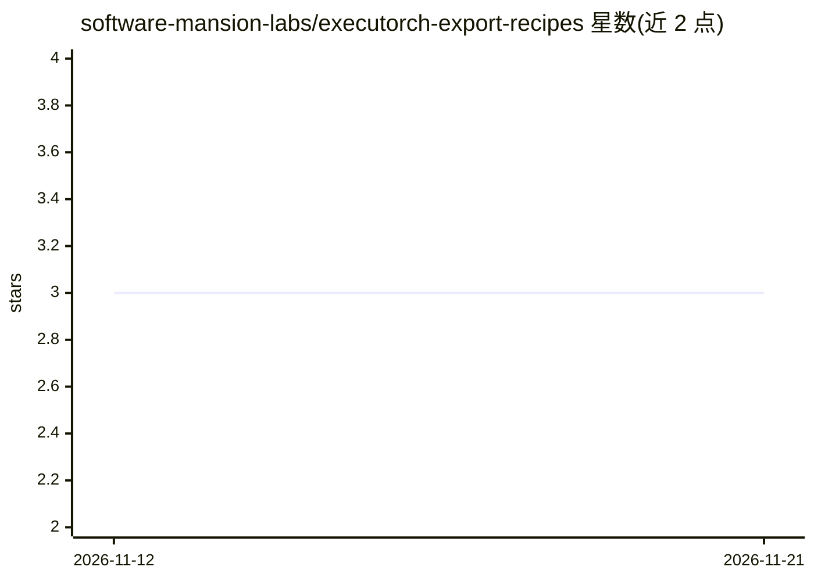

# software-mansion-labs/executorch-export-recipes

⭐ 3 · Python · NOASSERTION · 推送 2026-11-20 · [GitHub](https://github.com/software-mansion-labs/executorch-export-recipes) · [官网](https://executorch.swmansion.com) · 组织维护

**为开发者提供面向 ExecuTorch 的模型导出、验证与优化的配方集**

由 Software Mansion 维护的模型导出配方集合与 CLI 工具：每个模型带有独立导出脚本、锁定依赖与 I/O 规范，CLI 可发现配方并执行导出，生成 ExecuTorch 所用的 .pte 文件。仓库内置 agent 技能文档，覆盖导出失败恢复、输出校验、性能剖析与优化流程。支持 XNNPACK/CoreML/MLX/Vulkan 后端，当前模型依赖锁定针对 Apple Silicon 上的 macOS；Vulkan 与部分 MLX 配方需源码构建的 ExecuTork 分支。

## 筛选速览

| 维度 | 判定 | 备注 |
|---|---|---|
| AI 角色 | `ai-ecosystem` | LLM/agent 周边工具 |
| 许可风险 | `permissive` | NOASSERTION |
| 部署形态 | `None` |  |
| 模型依赖 | — | README 未给出锁定关系 |
| 硬件要求 | — | 无带数字的原话,不猜 |
| 安装摩擦 | `low` | 无编译、无系统依赖或容器化 |
| 成熟度 | — | 结构信号不足 |

## 能力要点

- 每个模型独立锁定依赖栈与导出脚本，不兼容栈可共存
- 面向 coding agent 的仓库内技能与工作流指引（AGENTS.md + SKILL.md）
- CLI 支持按 size/backend/precision 选择导出变体，含 --dry-run 预演
- 覆盖文本生成、视觉、检测、语音、OCR、嵌入等多类模型配方

## 适用场景

- 把 PyTorch 模型导出为可在移动/边缘端运行的 ExecuTorch 格式
- 针对不同后端（CoreML/XNNPACK/Vulkan/MLX）验证和优化模型推理速度
- 让 coding agent 按仓库流程添加新导出配方或修复失败的导出

## 场景标签

 · 领域:AI 基础设施/模型部署

## 证据(README 行号)

> L3: **An agent-first harness and collection of model recipes for exporting,
> L13: specification. The CLI discovers recipes and runs exports. Repository skills
> L24: |Export harness|Discover models, select sizes/backends/variants, resolve configs, and invoke the owning export scri

## 星数曲线

2026-11-12 3 → 2026-11-21 3（+0）

---
*卡片 v1 · prompt 1.4 · 生成 2026-11-21 · 置信度 high · 依据 README sha `af418111fe7b` · [字段定义](../../DATASET.md)*
