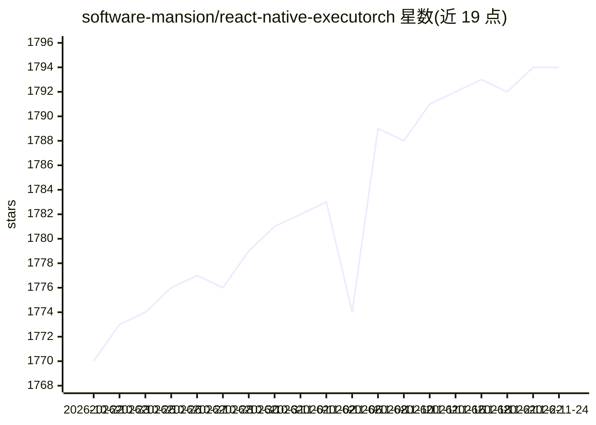

# software-mansion/react-native-executorch

⭐ 1,795 · TypeScript · NOASSERTION · 推送 2026-11-23 · [GitHub](https://github.com/software-mansion/react-native-executorch) · [官网](https://executorch.swmansion.com) · 组织维护

**React Native 端侧 AI 推理库：手机本地运行模型**

基于 Meta ExecuTorch 运行时的 React Native 端侧推理库，支持零网络调用、完全离线、数据不出设备的模型推理。内置覆盖计算机视觉、LLM、语音转文字、文字转语音等任务的预导出模型目录（托管于 Hugging Face），也可加载自定义 .pte 模型或用 TypeScript 低层原语构建自定义管线。要求 React Native 新架构、RN 0.83+/Expo SDK 55+（不支持 Expo Go），iOS 17+ / Android 8+。

## 筛选速览

| 维度 | 判定 | 备注 |
|---|---|---|
| AI 角色 | `ai-ecosystem` | LLM/agent 周边工具 |
| 许可风险 | `none` | NOASSERTION |
| 部署形态 | `library` | 以包/库形式分发 |
| 模型依赖 | — | README 未给出锁定关系 |
| 硬件要求 | — | 无带数字的原话,不猜 |
| 安装摩擦 | `low` | 无编译、无系统依赖或容器化 |
| 成熟度 | — | 结构信号不足 |

## 能力要点

- 硬件加速后端：XNNPACK (CPU)、Core ML 与 MLX (Apple Silicon)、Vulkan (Android GPU)
- use<Task> 任务钩子开箱支持 LLM、视觉、语音与嵌入，含缓存与生命周期管理
- 预导出模型目录 + 自定义 .pte 模型接入
- 提供面向 AI coding agent 的 consumer skill 安装

## 适用场景

- 在移动应用中离线运行 LLM 对话
- 端侧图像检测、OCR 等视觉任务
- 移动端语音转文字与文字转语音
- 在设备本地文档上做 RAG

## 场景标签

`语音合成` `RAG` `目标检测` `OCR` · 领域:内容生成

## 证据(README 行号)

> L11: **React Native ExecuTorch** is an on-device AI inference library for React Native, powered by ExecuTorch — Meta's o
> L31:  - **Ready-to-use Task Hooks (`use<Task>`)**: Out-of-the-box support for LLMs, computer vision, speech, and embeddi
> L28: - **Native Hardware Acceleration**: Optimized execution delegates across backends: **XNNPACK** (CPU), **Core ML** &

## 星数曲线

2026-10-22 1,770 → 2026-11-24 1,794（+24）

---
*卡片 v1 · prompt 1.4 · 生成 2026-11-23 · 置信度 high · 依据 README sha `dabcaada10b7` · [字段定义](../../DATASET.md)*
