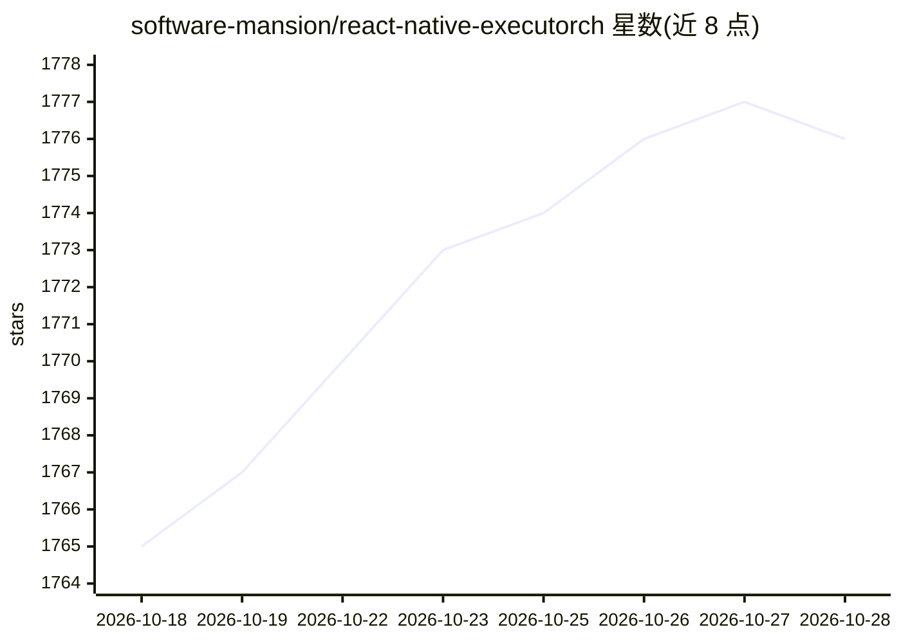

# software-mansion/react-native-executorch

⭐ 1,776 · TypeScript · NOASSERTION · 推送 2026-10-27 · [GitHub](https://github.com/software-mansion/react-native-executorch) · [官网](http://docs.swmansion.com/react-native-executorch/) · 组织维护

**React Native 应用内的端侧 AI 推理库，基于 ExecuTorch 运行模型**

面向 React Native 开发者的端侧推理库：通过 Meta 的 ExecuTorch 运行时把机器学习模型直接跑在用户手机上，零网络调用、全离线。提供两层架构——开箱即用的 use<Task> Hook（LLM、计算机视觉、语音、嵌入）与低层级运行时以 TypeScript 构建自定义流水线；附预导出模型目录（Hugging Face Collection），也支持自带 .pte 模型。执行后端含 XNNPACK、Core ML/MLX、Vulkan。要求 New Architecture、RN 0.83+/Expo SDK 55+（不支持 Expo Go）、iOS 17+/Android 13+。

## 筛选速览

| 维度 | 判定 | 备注 |
|---|---|---|
| AI 角色 | `ai-ecosystem` | LLM/agent 周边工具 |
| 许可风险 | `none` | NOASSERTION |
| 部署形态 | `library` | 以包/库形式分发 |
| 模型依赖 | — | README 未给出锁定关系 |
| 硬件要求 | — | 无带数字的原话,不猜 |
| 安装摩擦 | `low` | 无编译、无系统依赖或容器化 |
| 成熟度 | — | 结构信号不足 |

## 能力要点

- 端侧推理，零网络调用与全离线运行
- use<Task> Hook 覆盖 LLM、CV、语音、嵌入，含自动缓存与生命周期管理
- 低层级运行时支持 TypeScript 自定义流水线与张量运算
- 预导出模型目录（Hugging Face Collection）开箱即用，支持自带 .pte 模型

## 适用场景

- 在 React Native 应用中集成离线 LLM 对话或转录功能
- 构建零云端成本、数据不出设备的隐私优先 AI 功能
- 复用现成 CV/OCR/目标检测模型或接入自定义 .pte 模型

## 场景标签

`推理引擎` `目标检测` `OCR` `语音识别` · 领域:感知与多模态

## 证据(README 行号)

> L11: **React Native ExecuTorch** is an on-device AI inference library for React Native, powered by ExecuTorch — Meta's o
> L29:  - **Lower-level Runtime & Custom Orchestration**: Build custom pipelines entirely in TypeScript using low-level te

## 星数曲线

2026-10-18 1,765 → 2026-10-28 1,776（+11）

---
*卡片 v1 · prompt 1.4 · 生成 2026-10-21 · 置信度 high · 依据 README sha `487004b44f26` · [字段定义](../../DATASET.md)*
