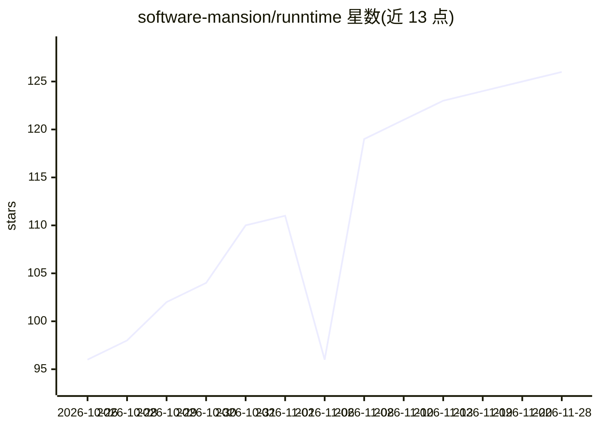

# software-mansion/runntime

⭐ 126 · TypeScript · MIT · 推送 2026-11-27 · [GitHub](https://github.com/software-mansion/runntime) · [官网](http://docs.swmansion.com/runntime/) · 组织维护

**Web 开发者在浏览器 GPU 上运行 AI 模型的 TypeScript 推理引擎**

基于 TypeGPU 构建的 AI 模型运行框架：将 GPU kernel 组合成 attention、卷积、归一化等模型层，以 TypeGPU 代码在运行时编译为 WGSL，无需下载 WASM 二进制；同一套代码可在支持 WebGPU 的浏览器、React Native 和 Electron 中运行。提供 zoo 入口，通过单个工厂函数加载语音识别、目标检测、深度估计、嵌入等任务模型，权重从 Hugging Face Hub 下载并支持 OPFS 缓存。运行需 WebGPU 支持，部分任务需 shader-f16 特性。

## 筛选速览

| 维度 | 判定 | 备注 |
|---|---|---|
| AI 角色 | `ai-ecosystem` | LLM/agent 周边工具 |
| 许可风险 | `permissive` | MIT |
| 部署形态 | `library` | 以包/库形式分发 |
| 模型依赖 | — | README 未给出锁定关系 |
| 硬件要求 | — | 无带数字的原话,不猜 |
| 安装摩擦 | `low` | 无编译、无系统依赖或容器化 |
| 成熟度 | — | 结构信号不足 |

## 能力要点

- 每个任务一个工厂函数（如 createObjectDetector），单次调用获得加载好的模型
- kernel 以 TypeGPU 代码在运行时编译为 WGSL，无需 WASM 二进制
- 可作为 transformers.js 的后端替换，保留 pipeline() 代码
- 覆盖嵌入、语音转文字、目标检测、分割、姿态、深度估计、图像分类等任务

## 适用场景

- 在浏览器端侧运行目标检测或图像分类模型
- 为 React Native / Electron 应用添加本地语音转文字能力
- 在现有 transformers.js 项目中替换推理后端

## 场景标签

`语音识别` `目标检测` `推理引擎` · 领域:感知与多模态

## 证据(README 行号)

> L5: **ruNNtime** is a framework for running AI models on the user's own GPU,
> L15: - **`runntime/zoo`** - ready-to-run model implementations for commonly used tasks: speech, vision, and natural lang
> L16: - **`runntime/core`** - this package is not yet exposed to the public. It is a set of pre-built kernels for buildin

## 星数曲线

2026-10-26 96 → 2026-11-28 126（+30）

---
*卡片 v1 · prompt 1.4 · 生成 2026-11-28 · 置信度 high · 依据 README sha `87dc5b24e050` · [字段定义](../../DATASET.md)*
