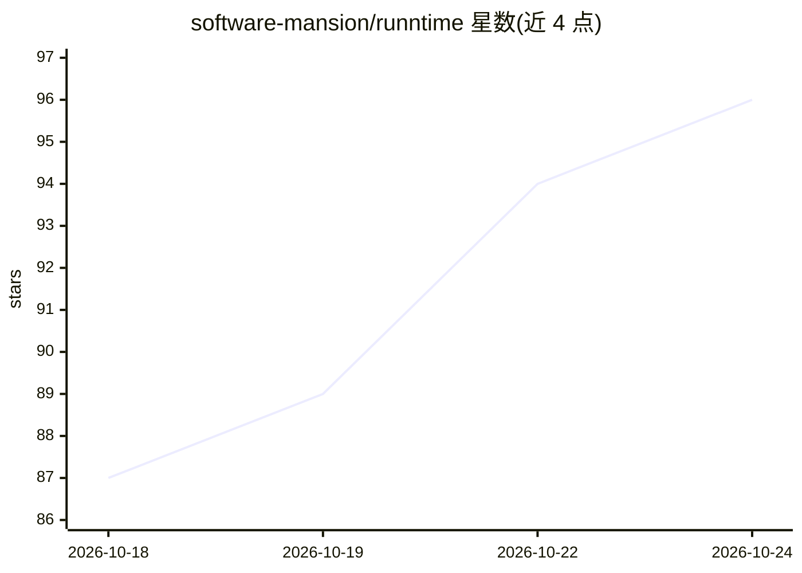

# software-mansion/runntime

⭐ 96 · TypeScript · MIT · 推送 2026-10-23 · [GitHub](https://github.com/software-mansion/runntime) · [官网](http://docs.swmansion.com/runntime/) · 组织维护

**面向 Web 前端开发者的浏览器 GPU 神经网络运行框架**

基于 TypeGPU 构建的 WebGPU 神经网络框架：将 GPU kernel 组合为注意力、卷积、归一化、矩阵乘等层，kernel 运行时编译为 WGSL，无需下载 WASM 二进制。同一代码可在浏览器、React Native 和 Electron 中运行。提供 runntime/zoo（一个函数即得可用模型，覆盖嵌入、语音转文字、目标检测、分割、姿态、深度估计、图像分类等任务）与尚未公开的 runntime/core。模型权重从 Hugging Face Hub 仓库下载，支持 OPFS 缓存；另提供替换 transformers.js 后端的接口。

## 筛选速览

| 维度 | 判定 | 备注 |
|---|---|---|
| AI 角色 | `ai-ecosystem` | LLM/agent 周边工具 |
| 许可风险 | `permissive` | MIT |
| 部署形态 | `library` | 以包/库形式分发 |
| 模型依赖 | — | README 未给出锁定关系 |
| 硬件要求 | — | 无带数字的原话,不猜 |
| 安装摩擦 | `low` | 无编译、无系统依赖或容器化 |
| 成熟度 | `idea` | |

## 能力要点

- kernel 编译为 WGSL，无 WASM 二进制需下载
- 同一代码运行于浏览器、React Native、Electron（需 WebGPU）
- zoo 提供嵌入/语音转文字/检测/分割/姿态/深度/分类等任务的一函数式模型工厂
- initRunntimeBackend() 可作为 transformers.js 的替代后端

## 适用场景

- 在网页中直接用用户 GPU 运行目标检测或语音转文字
- 为现有 transformers.js pipeline 更换 WebGPU 后端
- 跨浏览器、React Native、Electron 复用同一套推理代码

## 场景标签

`推理引擎` · 领域:训练与推理

## 证据(README 行号)

> L5: **ruNNtime** is a framework for running AI models on the user's own GPU,
> L6: implemented using TypeGPU. It composes GPU kernels into the layers a model is
> L15: - **`runntime/zoo`** - ready-to-run model implementations for commonly used tasks: speech, vision, and natural lang

## 星数曲线

2026-10-18 87 → 2026-10-24 96（+9）

---
*卡片 v1 · prompt 1.4 · 生成 2026-10-23 · 置信度 high · 依据 README sha `12fca8c85c40` · [字段定义](../../DATASET.md)*
