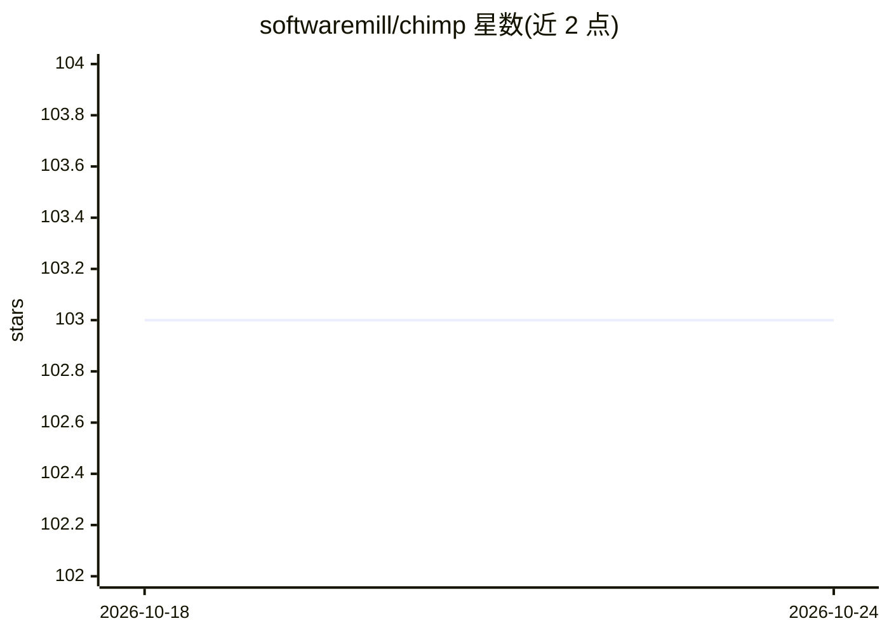

# softwaremill/chimp

⭐ 103 · Scala · Apache-2.0 · 推送 2026-10-24 · [GitHub](https://github.com/softwaremill/chimp) · [官网](https://chimp.softwaremill.com) · 组织维护

**Scala 3 构建 MCP 服务器与客户端的 SDK**

基于 Tapir 与 sttp 的 Scala 3 SDK，用于构建类型安全、少样板代码的 MCP（Model Context Protocol）服务器与客户端。实现 streamable HTTP 与 stdio 两种传输；集成模块（Ox、ZIO、Pekko）提供服务器与客户端间的双向流式通信。示例展示以 Netty 运行服务器、以子进程 stdio 方式连接，以及工具调用过程中的通知接收。以 Scala 依赖形式提供，文档见 chimp.softwaremill.com，由 SoftwareMill 提供。

## 筛选速览

| 维度 | 判定 | 备注 |
|---|---|---|
| AI 角色 | `ai-ecosystem` | LLM/agent 周边工具 |
| 许可风险 | `permissive` | Apache-2.0 |
| 部署形态 | `None` |  |
| 模型依赖 | — | README 未给出锁定关系 |
| 硬件要求 | — | 无带数字的原话,不猜 |
| 安装摩擦 | `low` | 无编译、无系统依赖或容器化 |
| 成熟度 | — | 结构信号不足 |

## 能力要点

- 基于 Tapir/sttp 的类型安全、少样板 MCP API
- 支持 streamable HTTP 与 stdio 两种传输
- Ox/ZIO/Pekko 集成模块支持双向流式通信
- 同时提供服务器端与客户端端 SDK

## 适用场景

- 在 Scala 项目中实现 MCP 服务器暴露工具
- 编写 MCP 客户端连接并调用工具
- 构建需要双向流式通知的 MCP 应用

## 场景标签

 · 领域:AI 基础设施/协议 SDK

## 证据(README 行号)

> L6: An SDK for building MCP (Model Context Protocol) servers and
> L7: clients in Scala 3 using boilerplate-less, type-safe APIs based on Tapir

## 星数曲线

2026-10-18 103 → 2026-10-24 103（+0）

---
*卡片 v1 · prompt 1.4 · 生成 2026-10-23 · 置信度 high · 依据 README sha `ea74c78dab19` · [字段定义](../../DATASET.md)*
