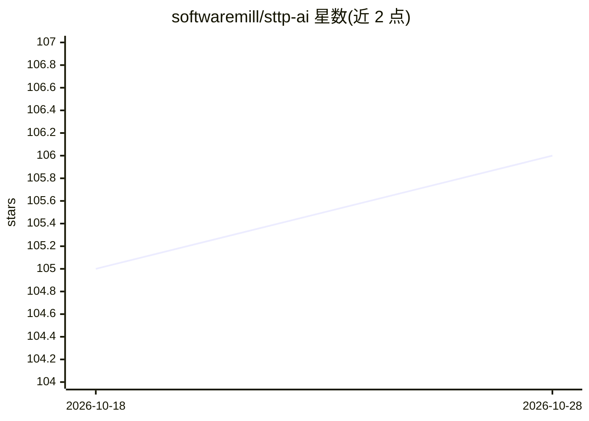

# softwaremill/sttp-ai

⭐ 106 · Scala · Apache-2.0 · 推送 2026-10-28 · [GitHub](https://github.com/softwaremill/sttp-ai) · [官网](https://sttp-ai.softwaremill.com) · 组织维护

**Scala 的 LLM 客户端工具包：接入多家模型 API 并构建 agent**

sttp 生态下的非官方 Scala 客户端封装库，基于 sttp client 描述请求/响应，接入 OpenAI、Claude（Anthropic）、Gemini（Google）、Jev（TypeSafe AI）及 OpenAI 兼容端点（如 Ollama、Grok、OpenRouter）。按 provider 分模块发布（openai/claude/gemini/jev），通过 sbt 依赖引入，支持 Scala 2.12/2.13/3（Jev 仅 Scala 3）。功能包括流式输出、结构化输出、工具调用、agent 循环，并提供 agent-testkit 模块在无付费 API 的情况下测试 agent。

## 筛选速览

| 维度 | 判定 | 备注 |
|---|---|---|
| AI 角色 | `ai-ecosystem` | LLM/agent 周边工具 |
| 许可风险 | `permissive` | Apache-2.0 |
| 部署形态 | `None` |  |
| 模型依赖 | locked-api |  |
| 硬件要求 | — | 无带数字的原话,不猜 |
| 安装摩擦 | `low` | 无编译、无系统依赖或容器化 |
| 成熟度 | — | 结构信号不足 |

## 能力要点

- 分模块接入 OpenAI/Claude/Gemini/Jev 及 OpenAI 兼容端点
- 支持流式输出、结构化输入输出与工具调用
- 提供 agent-testkit 模块，无付费 API 即可测试 agent
- 基于 sttp client 构建，覆盖 Scala 2.12/2.13/3

## 适用场景

- 在 Scala 项目中调用 OpenAI、Claude、Gemini 等 LLM API
- 构建带工具调用与 agent 循环的应用
- 离线测试 agent 逻辑而不产生 API 费用

## 场景标签

`模型网关` `Agent 框架` · 领域:Agent 开发

## 证据(README 行号)

> L16: * sttp ai: this project. Non-official Scala client wrapper for OpenAI, Claude (Anthropic), Gemini (Google), Jev (Ty
> L18: sttp-ai uses sttp client to describe requests and responses used in OpenAI, Claude (Anthropic), Gemini (Google), Je
> L66: Then head to the documentation for usage examples: OpenAI, Claude, and Gemini clients, streaming, structured output

## 星数曲线

2026-10-18 105 → 2026-10-28 106（+1）

---
*卡片 v1 · prompt 1.4 · 生成 2026-10-23 · 置信度 high · 依据 README sha `ea408dcbfcb9` · [字段定义](../../DATASET.md)*
