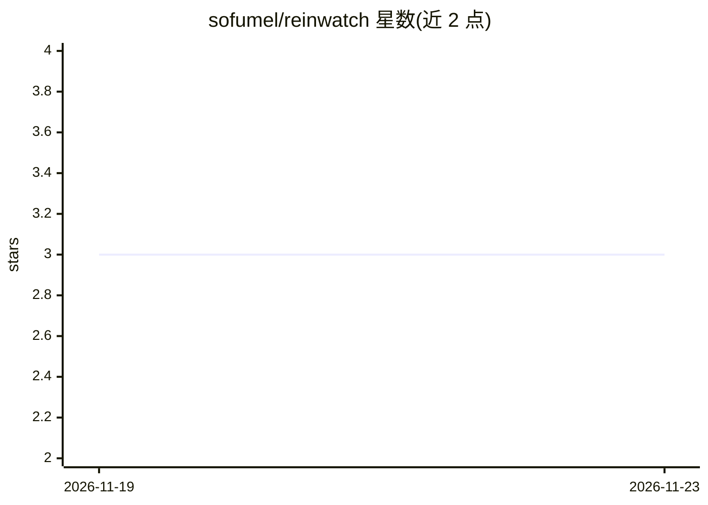

# sofumel/reinwatch

⭐ 3 · TypeScript · MIT · 推送 2026-11-19 · [GitHub](https://github.com/sofumel/reinwatch) · 个人维护

**监控并叫停 Claude Code 子代理的令牌与失控看门插件**

以 Claude Code 插件形式安装的 TypeScript hooks 模块，为 Claude Code 运行的子代理、队友和工作流代理提供逐代理的新增令牌计数、只计模型/工具工作的活跃时长、失控与卡滞警告（通知与回合小结、30 天累计）、以及手动 Stop/Ask to stop。无网络访问、无 shell 命令、无模型调用；仅保留 30 天本地统计，不保存提示词与工具输入。要求 Claude Code 2.1.300+。

## 筛选速览

| 维度 | 判定 | 备注 |
|---|---|---|
| AI 角色 | `ai-ecosystem` | LLM/agent 周边工具 |
| 许可风险 | `permissive` | MIT |
| 部署形态 | `None` |  |
| 模型依赖 | — | README 未给出锁定关系 |
| 硬件要求 | — | 无带数字的原话,不猜 |
| 安装摩擦 | `low` | 无编译、无系统依赖或容器化 |
| 成熟度 | — | 结构信号不足 |

## 能力要点

- 逐代理令牌计数与仅计模型/工具工作的活跃时长
- 六类警告（长跑、令牌、重复调用、连续失败、爆发、工作流规模）+30 天历史
- 可对单个代理（含工作流内）手动 Stop，无自动停止
- 无网络、无 shell、无模型调用，仅存 30 天本地统计

## 适用场景

- 担心 Claude Code 后台代理跑飞令牌，想设阈值收警告
- 逐个查看并叫停失控或卡住的子代理
- 配置输入/输出单价后估算各代理与整场会话成本

## 场景标签

`LLM 可观测性` · 领域:评测与运维

## 证据(README 行号)

> L8:  TypeScript hooks module
> L10:  A token and runaway watchdog for the subagents, teammates and workflow agents Claude Code runs: per-agent tokens, 
> L51: Requires Claude Code 2.1.300 or later, in the terminal or the desktop app's Code tab.

## 星数曲线

2026-11-19 3 → 2026-11-23 3（+0）

---
*卡片 v1 · prompt 1.4 · 生成 2026-11-21 · 置信度 high · 依据 README sha `a42ca262f318` · [字段定义](../../DATASET.md)*
