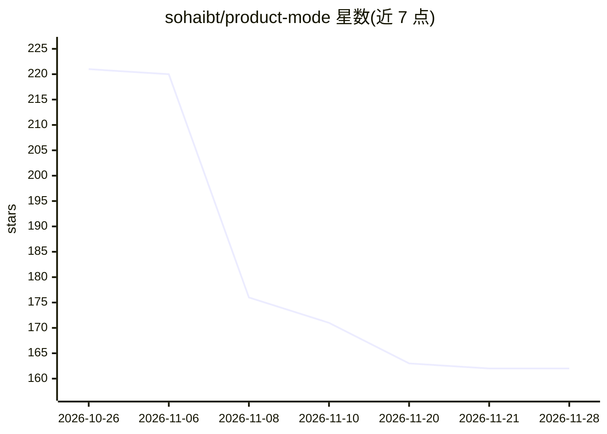

# sohaibt/product-mode

⭐ 162 · TypeScript · MIT · 推送 2026-11-21 · [GitHub](https://github.com/sohaibt/product-mode) · [官网](https://sohaibthiab.me/product-mode/) · 个人维护

**给编码 agent 注入产品判断力的 CLAUDE.md/AGENTS.md 指令集**

一组 MIT 许可的指令文件（CLAUDE.md/AGENTS.md），可直接放入使用 Claude Code、Cursor、Codex 等编码 agent 的项目，向 agent 注入七条产品原则：问题框定、假设显性化、最小可行变更、权衡命名、以结果定义完成、上线前埋点、决策日志；另含五问预检清单与可跳过严谨流程的判定表。可选的 npm CLI 提供交互式 checklist/decision 命令、trivial 变更检测与三个 slash 命令，产物保存在 .product-mode/ 目录。面向 PM+工程混合团队与独立创始人。

## 筛选速览

| 维度 | 判定 | 备注 |
|---|---|---|
| AI 角色 | `ai-ecosystem` | LLM/agent 周边工具 |
| 许可风险 | `permissive` | MIT |
| 部署形态 | `library` | 以包/库形式分发 |
| 模型依赖 | — | README 未给出锁定关系 |
| 硬件要求 | — | 无带数字的原话,不猜 |
| 安装摩擦 | `low` | 无编译、无系统依赖或容器化 |
| 成熟度 | — | 结构信号不足 |

## 能力要点

- 七条产品原则指令文件，drop-in 兼容 CLAUDE.md/AGENTS.md 格式
- 可选 npm CLI：checklist、decision、trivial 变更检测
- init 安装 /preflight、/decision、/product-review 三个 agent slash 命令
- 自带六个评估用例与 Node 20.19/22/24 的 CI 测试

## 适用场景

- AI 辅助开发前让 agent 先做问题框定与范围裁剪
- 团队把预检清单和决策记录沉淀到仓库供后续 agent 读取
- 用 trivial 检测判断小改动可否跳过完整流程

## 场景标签

`提示工程` · 领域:Agent 开发

## 证据(README 行号)

> L5: **Give your coding agent product judgment before it starts building.**
> L7: Free, MIT-licensed instructions for framing the problem, cutting scope, naming tradeoffs, and defining success. A dr
> L101: The instruction files work on their own. The CLI provides interactive commands that save checklists and decision l

## 星数曲线

2026-10-26 221 → 2026-11-28 162（-59）

---
*卡片 v1 · prompt 1.4 · 生成 2026-11-27 · 置信度 high · 依据 README sha `f65588abad02` · [字段定义](../../DATASET.md)*
