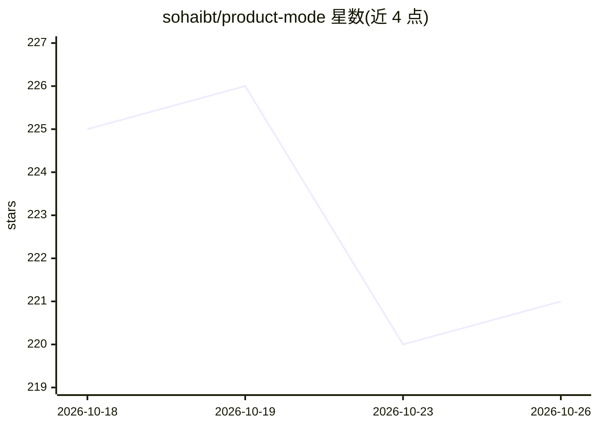

# sohaibt/product-mode

⭐ 221 · TypeScript · MIT · 推送 2026-10-10 · [GitHub](https://github.com/sohaibt/product-mode) · [官网](https://sohaibthiab.me/product-mode/) · 个人维护

**给编码 Agent 注入产品思维的 CLAUDE.md/AGENTS.md 指令文件**

面向 PM 与工程团队的 MIT 许可指令文件：以 CLAUDE.md / AGENTS.md 形式供 Claude Code、Cursor、Codex 等编码代理读取，提供 7 条产品原则（问题框定、假设显性化、最小可行变更、权衡命名、以结果定义完成、发布前埋点、决策记录）及飞行前检查清单。可选 npm CLI 用于交互式保存检查清单与决策日志到 .product-mode/ 目录，要求 Node.js 20.19+。基于 karpathy 对 LLM 工程失效模式的观察，补充产品决策层面的指引。

## 筛选速览

| 维度 | 判定 | 备注 |
|---|---|---|
| AI 角色 | `ai-ecosystem` | LLM/agent 周边工具 |
| 许可风险 | `permissive` | MIT |
| 部署形态 | `library` | 以包/库形式分发 |
| 模型依赖 | — | README 未给出锁定关系 |
| 硬件要求 | — | 无带数字的原话,不猜 |
| 安装摩擦 | `low` | 无编译、无系统依赖或容器化 |
| 成熟度 | `idea` | |

## 能力要点

- 7 条产品原则 + 5 问飞行前检查清单与跳过严格度的表格
- 指令文件可直接 curl 下载或合并进现有 CLAUDE.md，无需 npm 安装
- 可选 CLI 保存检查清单、决策日志并做琐碎变更检测
- 附 6 个作者编写的评估用例，README 声明非实测性能证据

## 适用场景

- 让 AI 编码代理在写代码前先框定问题、明确用户与成功指标
- 团队以决策日志和检查清单约束范围蔓延
- PM 用 vibe-code 工具时希望代理以产品伙伴方式提问

## 场景标签

`提示工程` · 领域:Agent 开发

## 证据(README 行号)

> L7: Free, MIT-licensed instructions for framing the problem, cutting scope, naming tradeoffs, and defining success. A dr
> L79: **product-mode** adds the missing layer: problem framing, scope discipline, tradeoff articulation, outcome measurem
> L99: The instruction files work on their own. The CLI provides interactive commands that save checklists and decision lo

## 星数曲线

2026-10-18 225 → 2026-10-26 221（-4）

---
*卡片 v1 · prompt 1.4 · 生成 2026-10-22 · 置信度 high · 依据 README sha `98b27b1139d8` · [字段定义](../../DATASET.md)*
