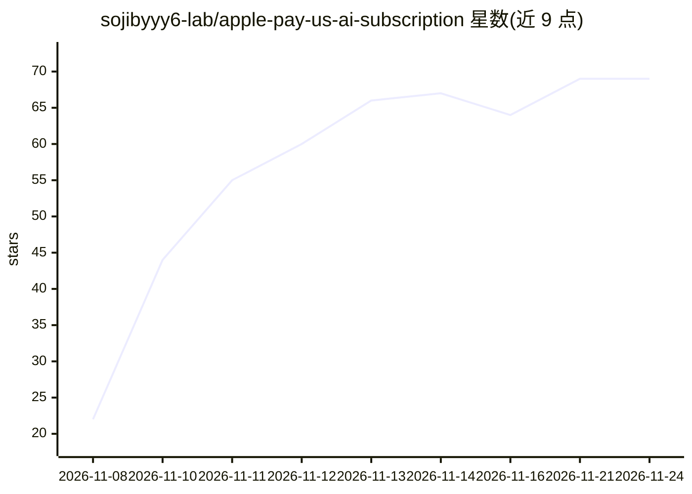

# sojibyyy6-lab/apple-pay-us-ai-subscription

⭐ 69 · 推送 2026-11-04 · [GitHub](https://github.com/sojibyyy6-lab/apple-pay-us-ai-subscription) · [官网](https://app.coregold.io/signup?invite_code=ADvlj9b) · 组织维护 · 中文 README

**教程：用 CoreGold 虚拟卡绑 Apple Pay 订阅海外 AI 服务**

内容为一篇操作指南，讲解如何通过 CoreGold 平台用 USDT 开通美区商业卡段虚拟卡，挂载至 Apple Wallet，再在 ChatGPT、Claude、Perplexity 等 AI 服务的 iOS 内购或支持 Apple Pay 的网页结算页完成订阅扣费。README 对比了国内双币卡在网页端 Stripe 风控下的失败情况与 Apple Pay 代扣链路的差异，并给出三步部署流程。本仓库不包含可安装运行的软件，仅含指南文本与开卡入口链接。

## 筛选速览

| 维度 | 判定 | 备注 |
|---|---|---|
| AI 角色 | `ai-knowledge` | 知识聚合/清单类 |
| 许可风险 | `none` | — |
| 部署形态 | `None` |  |
| 模型依赖 | — | README 未给出锁定关系 |
| 硬件要求 | — | 无带数字的原话,不猜 |
| 安装摩擦 | `low` | 无编译、无系统依赖或容器化 |
| 成熟度 | — | 结构信号不足 |

## 能力要点

- 讲解美区 Apple ID 绑定 CoreGold 虚拟卡的完整流程
- 对比网页端 Stripe 直接绑卡与 Apple Pay 代扣链路
- 给出 CoreGold 商业卡段（414742/556167）的绑卡与扣款情况说明

## 适用场景

- 没有美区信用卡的用户想订阅 ChatGPT Plus、Claude Pro 等服务
- 希望规避网页端绑卡被风控拦截的用户参考操作步骤

## 场景标签

`教程课程` · 领域:学习与行业

## 证据(README 行号)

> L2: Apple Pay 绑定美区虚拟卡指南：免风控订阅 ChatGPT、Claude 与海外 AI，破解无原生美卡难题。
> L5: 很多开发者和极客订阅海外 AI 服务（ChatGPT Plus、Claude Pro、Perplexity）时，网页端 Stripe 的风控拦截率极高。但通过 iOS 客户端的内购（In-App Purchase）或网页端直接调用 
> L29: 1. **入金并开卡**：登录 CoreGold 控制台 充入 USDT，开通支持 Apple Pay 的商业卡段，单卡设好硬限额。

## 星数曲线

2026-11-08 22 → 2026-11-24 69（+47）

---
*卡片 v1 · prompt 1.4 · 生成 2026-11-18 · 置信度 mid · 依据 README sha `7ac02649126e` · [字段定义](../../DATASET.md)*
