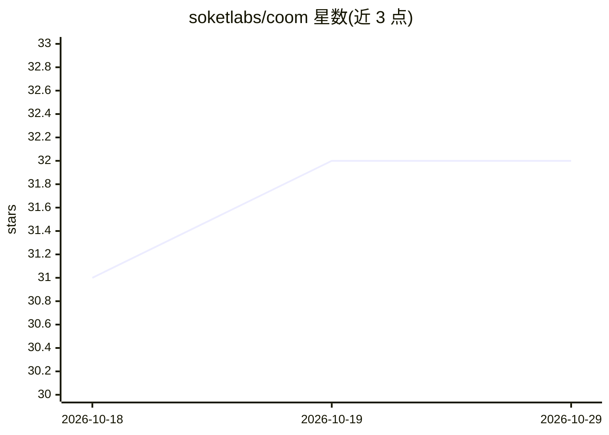

# soketlabs/coom

⭐ 32 · Python · NOASSERTION · 推送 2025-11-14 · [GitHub](https://github.com/soketlabs/coom) · [官网](https://eka.soket.ai) · 组织维护

**基于 Megatron-Core 的大模型训练框架，受 HAI-LLM 启发**

面向大规模语言模型预训练的框架，基于 Megatron-Core 构建，设计参考 DeepSeek HAI-LLM 的优化思路。目标包括高效扩展多语言大模型、提升训练效率；规划特性含 FP8 预训练、MoE、MLA、多 Token 预测、内核融合、KV-Cache 优化、专家负载均衡与渐进式模型扩展等。README 未给出安装命令或使用示例，且声明框架处于活跃开发中，性能指标将在后续版本发布。接受社区贡献，要求代码遵循 PEP 8。

## 筛选速览

| 维度 | 判定 | 备注 |
|---|---|---|
| AI 角色 | `ai-ecosystem` | LLM/agent 周边工具 |
| 许可风险 | `none` | NOASSERTION |
| 部署形态 | `None` |  |
| 模型依赖 | — | README 未给出锁定关系 |
| 硬件要求 | — | 无带数字的原话,不猜 |
| 安装摩擦 | `low` | 无编译、无系统依赖或容器化 |
| 成熟度 | `idea` | |

## 能力要点

- 基于 Megatron-Core，参考 DeepSeek HAI-LLM 优化
- 规划特性：FP8 预训练、MoE、MLA、多 Token 预测
- 面向大规模多语言模型的高效扩展
- 尚在活跃开发阶段，性能指标未发布

## 适用场景

- 大规模语言模型的预训练与扩展实验
- 复现 HAI-LLM 风格的训练优化（FP8/MoE/MLA）
- 研究高效训练技术并参与开源贡献

## 场景标签

`模型训练` · 领域:训练与推理

## 证据(README 行号)

> L4: A training framework for large-scale language models based on Megatron-Core, the COOM Training Framework is designed
> L9: - Develop an optimized pretraining framework based on Deepseek's HAI-LLM.

## 星数曲线

2026-10-18 31 → 2026-10-29 32（+1）

---
*卡片 v1 · prompt 1.4 · 生成 2026-10-25 · 置信度 mid · 依据 README sha `d67c03c094d1` · [字段定义](../../DATASET.md)*
