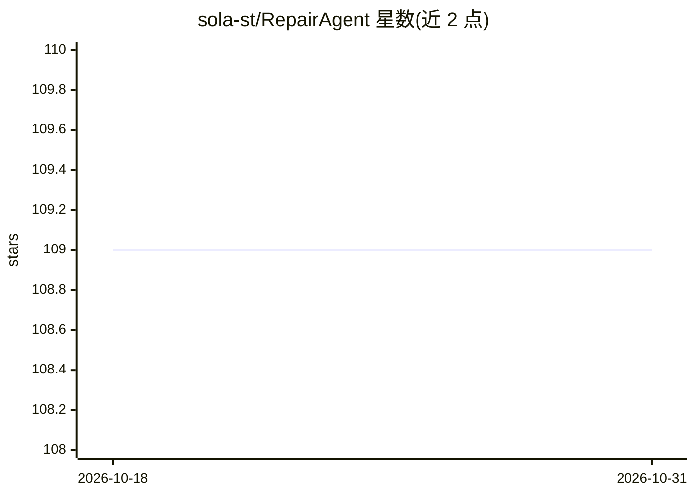

# sola-st/RepairAgent

⭐ 109 · Python · NOASSERTION · 推送 2026-09-07 · [GitHub](https://github.com/sola-st/RepairAgent) · [官网](https://arxiv.org/abs/2403.17134) · 组织维护

**自主修复 Java 项目缺陷的 LLM Agent 工具**

由 LLM 驱动的自主程序修复 agent：循环执行定位缺陷、分析代码、生成补丁、运行测试的流程，针对 Defects4J 基准中的 Java 缺陷工作，无需人工干预。支持 OpenAI 与 Anthropic 模型，通过交互式 CLI 或脚本模式运行，提供 Codespaces、Dev Container、Docker 与本地四种环境方式，运行需 Java 11、Perl 与 Defects4J。论文发表于 ICSE 2025，实验中在 Defects4J 上修复 164 个缺陷。

## 筛选速览

| 维度 | 判定 | 备注 |
|---|---|---|
| AI 角色 | `ai-native` | 本体是模型或模型工具 |
| 许可风险 | `permissive` | NOASSERTION |
| 部署形态 | `library` | 以包/库形式分发 |
| 模型依赖 | locked-api |  |
| 硬件要求 | — | 无带数字的原话,不猜 |
| 安装摩擦 | `medium` | 含编译或系统依赖之一 |
| 成熟度 | — | 结构信号不足 |

## 能力要点

- 定位→分析→生成补丁→测试的自主迭代循环，无需人工干预
- 支持 OpenAI 与 Anthropic 模型，未列出的模型名也可传入使用
- 提供 Codespaces / Dev Container / Docker / 本地四种环境方式与交互式向导 CLI
- 附带实验复现脚本与结果分析工具（汇总报告、token 成本统计等）

## 适用场景

- 在 Defects4J 基准上自动生成并验证 Java 缺陷修复补丁
- 复现论文实验并生成对比表格与结果报告
- 在 CI 脚本中以直接模式批量处理缺陷列表

## 场景标签

`编码 Agent` · 领域:编码与开发

## 证据(README 行号)

> L13: RepairAgent is an autonomous agent that fixes bugs in Java projects using LLMs.
> L27: > Published at ICSE 2025. RepairAgent is the first autonomous agent-based approach to automated program repair.

## 星数曲线

2026-10-18 109 → 2026-10-31 109（+0）

---
*卡片 v1 · prompt 1.4 · 生成 2026-10-23 · 置信度 mid · 依据 README sha `20f64f1dde72` · [字段定义](../../DATASET.md)*
