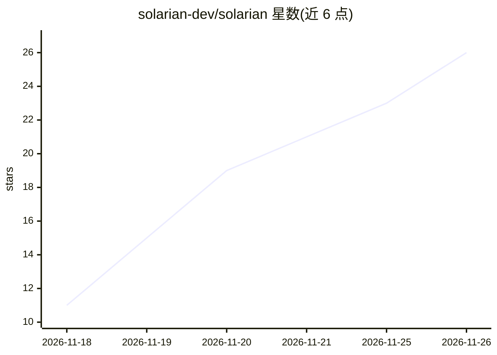

# solarian-dev/solarian

⭐ 26 · Python · Apache-2.0 · 推送 2026-11-24 · [GitHub](https://github.com/solarian-dev/solarian) · [官网](https://solarian.dev) · 组织维护

**给机器人开发者的开源 Python 框架：构建、仿真、训练并部署 AI 机器人**

开源 Python 机器人框架，覆盖构建、仿真、遥操作、训练与部署全流程：机器人以 Python 类表达，由模块（臂、夹爪、相机）组成，各模块独立进程按各自频率运行；内置运动学求解与 MuJoCo 仿真。训练路径以 UMI 为主，支持 ACT 与 diffusion policy，技能描述夹爪运动而非特定臂关节，可在兼容臂间复用。另提供围绕 VLM 的 Agentic Controller，以技能为工具执行高层任务。经 pip 安装，许可证为 Apache 2.0，模型权重单独下载并遵循上游许可。

## 筛选速览

| 维度 | 判定 | 备注 |
|---|---|---|
| AI 角色 | `ai-ecosystem` | LLM/agent 周边工具 |
| 许可风险 | `permissive` | Apache-2.0 |
| 部署形态 | `library` | 以包/库形式分发 |
| 模型依赖 | — | README 未给出锁定关系 |
| 硬件要求 | — | 无带数字的原话,不猜 |
| 安装摩擦 | `low` | 无编译、无系统依赖或容器化 |
| 成熟度 | — | 结构信号不足 |

## 能力要点

- 机器人建模为模块化 Python 类，模块独立进程运行（500 Hz 臂不等 30 Hz 相机）
- 以 UMI 为主要操作学习路径，技能可跨兼容机械臂复用
- Agentic Controller 接入任意 VLM（Anthropic/OpenAI/OpenAI 兼容服务），以技能为工具执行任务
- 同一项目经 --sim 在 MuJoCo 仿真或真实硬件上运行

## 适用场景

- 用同一套代码先在 MuJoCo 仿真再部署到真实机械臂
- 用手持夹爪采集演示数据并训练 UMI/diffusion/ACT 策略
- 通过聊天下达高层任务，让 VLM 控制器规划并调用机器人技能

## 场景标签

`模型训练` · 领域:训练与推理

## 证据(README 行号)

> L9: **Open-source Python framework to build, simulate, train and deploy AI robots, with open hardware that runs UMI poli
> L20: **Solarian** is an open-source robotics framework designed to build, simulate, teleoperate, train, and deploy robot
> L22: Solarian brings the developer experience of a modern Python library to robotics, and it is built around low level c

## 星数曲线

2026-11-18 11 → 2026-11-26 26（+15）

---
*卡片 v1 · prompt 1.4 · 生成 2026-11-18 · 置信度 high · 依据 README sha `7777048c7803` · [字段定义](../../DATASET.md)*
