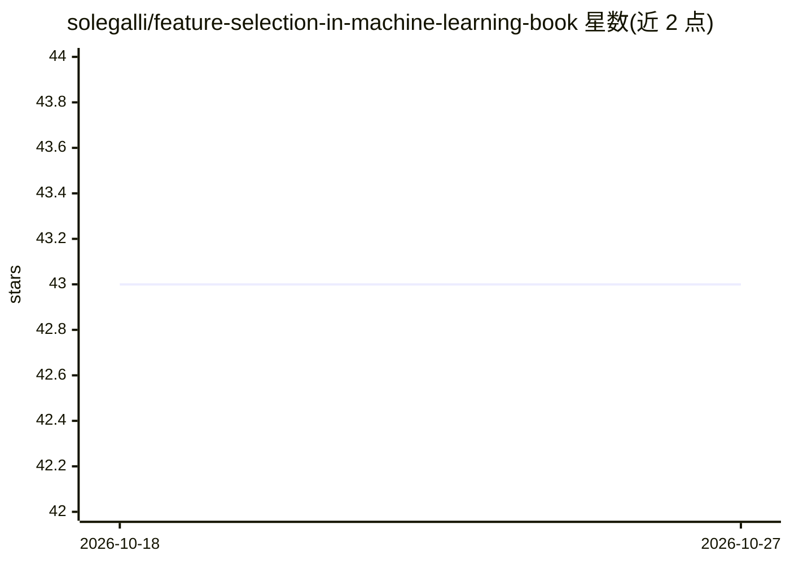

# solegalli/feature-selection-in-machine-learning-book

⭐ 43 · Jupyter Notebook · NOASSERTION · 推送 2026-05-05 · [GitHub](https://github.com/solegalli/feature-selection-in-machine-learning-book) · [官网](https://www.trainindata.com/p/feature-selection-in-machine-learning-book) · 个人维护

**《Feature Selection in Machine Learning》书籍配套代码仓库**

一本书的代码仓库，2022 年 8 月出版、2026 年 5 月更新，主题为机器学习中的特征选择，配套 Python/scikit-learn/feature-engine 生态的示例代码（recipes）。README 提供搭建运行环境的步骤：创建并激活 Python 虚拟环境，通过 pip 安装 requirements.txt 依赖，安装 Jupyter 与 ipykernel 并注册内核。书籍本体需另行购买，仓库仅含代码。

## 筛选速览

| 维度 | 判定 | 备注 |
|---|---|---|
| AI 角色 | `ai-knowledge` | 知识聚合/清单类 |
| 许可风险 | `none` | NOASSERTION |
| 部署形态 | `library` | 以包/库形式分发 |
| 模型依赖 | — | README 未给出锁定关系 |
| 硬件要求 | — | 无带数字的原话,不猜 |
| 安装摩擦 | `low` | 无编译、无系统依赖或容器化 |
| 成熟度 | — | 结构信号不足 |

## 能力要点

- 书籍配套的机器学习特征选择示例代码
- 提供虚拟环境创建与 Jupyter 内核注册的完整环境搭建步骤
- 依赖通过 requirements.txt 安装

## 适用场景

- 跟随书籍逐步运行特征选择示例代码
- 学习机器学习特征选择的 Python 实现方法

## 场景标签

`教程课程` · 领域:学习与行业

## 证据(README 行号)

> L4: ## Feature Selection in Machine Learning Book - Code Repository
> L6: - Published: August, 2022

## 星数曲线

2026-10-18 43 → 2026-10-27 43（+0）

---
*卡片 v1 · prompt 1.4 · 生成 2026-10-25 · 置信度 mid · 依据 README sha `850d0e9b9dc3` · [字段定义](../../DATASET.md)*
