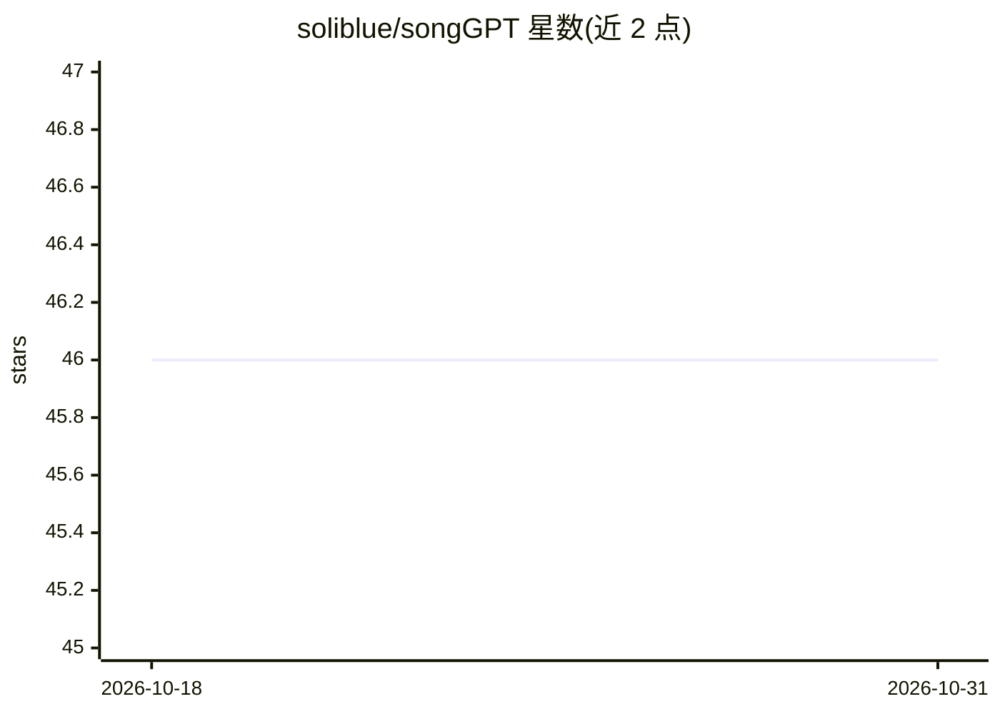

# soliblue/songGPT

⭐ 46 · Jupyter Notebook · MIT · 推送 2026-07-11 · [GitHub](https://github.com/soliblue/songGPT) · [官网](https://songgpt.soli.blue) · 个人维护

**用 LLM 生成 ABC 记谱乐曲并转 MIDI 的 Web 应用**

开源实验项目：用户提交提示词后，系统排队生成 ABC 记谱短曲，经 abc2midi 本地渲染为 MIDI，并在浏览器播放。托管架构基于 Cloudflare 免费层（Pages、Pages Functions、D1、R2），生成端通过已订阅的 Claude Code 或 Codex CLI 在 Cloudflare 外运行，输出结构化 JSON 后渲染上传。保留 FastAPI 后端作为本地/VPS 回退，使用 SQLite 与本地文件存储；Firebase 已迁移退役。限制：每客户端每小时 3 次请求、每日 250 个任务，需自备 CLI 订阅登录。

## 筛选速览

| 维度 | 判定 | 备注 |
|---|---|---|
| AI 角色 | `ai-native` | 本体是模型或模型工具 |
| 许可风险 | `permissive` | MIT |
| 部署形态 | `library` | 以包/库形式分发 |
| 模型依赖 | locked-api |  |
| 硬件要求 | — | 无带数字的原话,不猜 |
| 安装摩擦 | `low` | 无编译、无系统依赖或容器化 |
| 成熟度 | — | 结构信号不足 |

## 能力要点

- LLM 生成 ABC 记谱并经 abc2midi 转为 MIDI，浏览器播放
- Claude Code 与 Codex CLI 双生成通道，结构化 JSON 输出
- 托管路径全部运行在 Cloudflare 免费层（Pages/D1/R2）
- 保留 FastAPI + SQLite 的本地/VPS 回退后端

## 适用场景

- 输入提示词生成短小原创乐曲并下载 MIDI
- 研究 LLM 在音乐生成任务中的结构化输出能力
- 自部署一套 LLM 作曲服务供个人或小团体使用

## 场景标签

 · 领域:AI 音乐生成/Web 应用

## 证据(README 行号)

> L5: songGPT is an open-source project that generates short musical compositions in
> L11: The composer itself runs outside Cloudflare through an existing subscription CLI
> L42: 4. The worker runs Claude or Codex CLI with a JSON schema requiring `response`,

## 星数曲线

2026-10-18 46 → 2026-10-31 46（+0）

---
*卡片 v1 · prompt 1.4 · 生成 2026-10-25 · 置信度 high · 依据 README sha `7ca192546798` · [字段定义](../../DATASET.md)*
