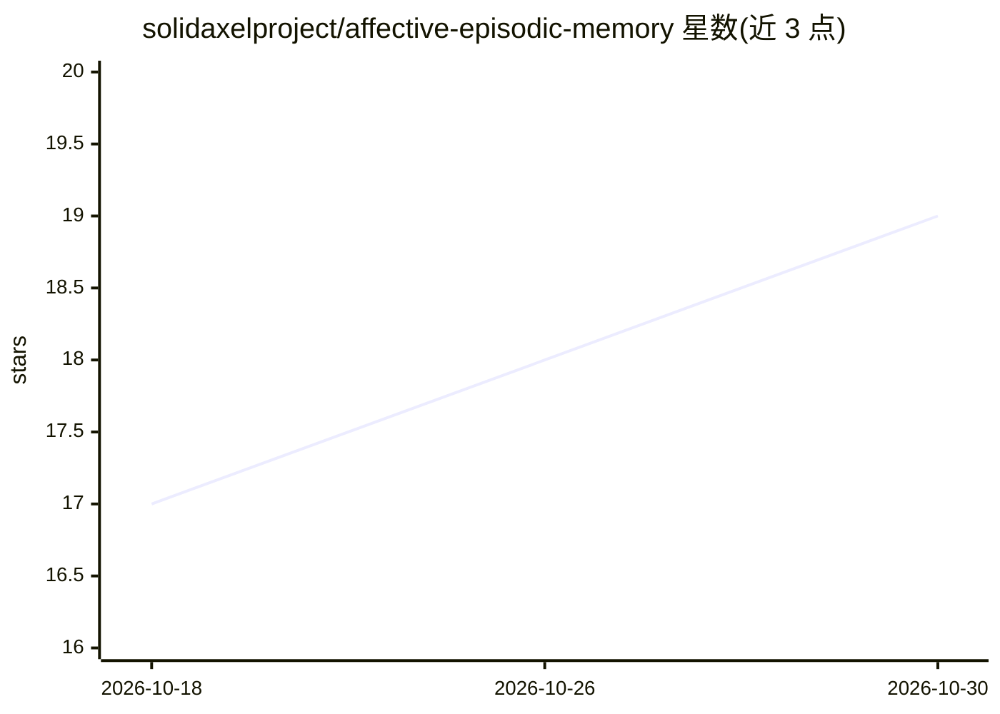

# solidaxelproject/affective-episodic-memory

⭐ 19 · Python · MIT · 推送 2026-10-24 · [GitHub](https://github.com/solidaxelproject/affective-episodic-memory) · 个人维护 · 中文 README

**为 AI agent 提供仿人类情感情景记忆与夜间固化系统**

面向 AI agent 的记忆系统研究项目：以人类记忆为模型，由三部分组成——基于 SQLite+FTS5 的记忆图（精度账本，含日期、原文与 51 维情感签名）、名为 Lux 的生长型神经网络器官（Grow-When-Required，新异性生神经元）、以及情绪稳态调节。记忆按语义与情感检索，夜间通过 GPU 跑固化流程（提取、标注、整合），白天召回在 CPU 上毫秒级运行。提供 60 秒 demo（仅依赖 numpy），用于研究 LLM 记忆机制与涌现行为，作者个人以功能性视角记录实验观察。

## 筛选速览

| 维度 | 判定 | 备注 |
|---|---|---|
| AI 角色 | `ai-ecosystem` | LLM/agent 周边工具 |
| 许可风险 | `permissive` | MIT |
| 部署形态 | `library` | 以包/库形式分发 |
| 模型依赖 | — | README 未给出锁定关系 |
| 硬件要求 | `cpu-ok` | |
| 安装摩擦 | `low` | 无编译、无系统依赖或容器化 |
| 成熟度 | — | 结构信号不足 |

## 能力要点

- 记忆图（SQLite+FTS5）+ 生长型器官 Lux + 稳态系统的三组件架构
- 情感签名基于 Plutchik 情绪轮，召回时将情感向量注入模型层
- 白天 CPU 毫秒级召回，夜间 GPU 固化的昼夜分离机制
- demo.py 仅需 numpy，无需 GPU/模型/数据即可运行

## 适用场景

- 为本地 LLM agent 添加带情感索引的长期情景记忆
- 研究类人记忆机制（重构、情绪一致性召回、固化）在 LLM 中的表现
- 观察大量记忆下的检索与涌现行为实验

## 场景标签

`Agent 记忆` · 领域:Agent 开发

## 证据(README 行号)

> L3: *A memory system for AI agents modeled on human memory. A memory returns with its emotion, consolidates during sleep
> L104: I set out to remedy this problem by attaching to the model a set of structures acting as the building blocks of hu
> L150: DAY      The agent lives (chat). Explicit recalls via the "memory" skill.

## 星数曲线

2026-10-18 17 → 2026-10-30 19（+2）

---
*卡片 v1 · prompt 1.4 · 生成 2026-10-29 · 置信度 low · 依据 README sha `1d81b0da9b70` · [字段定义](../../DATASET.md)*
