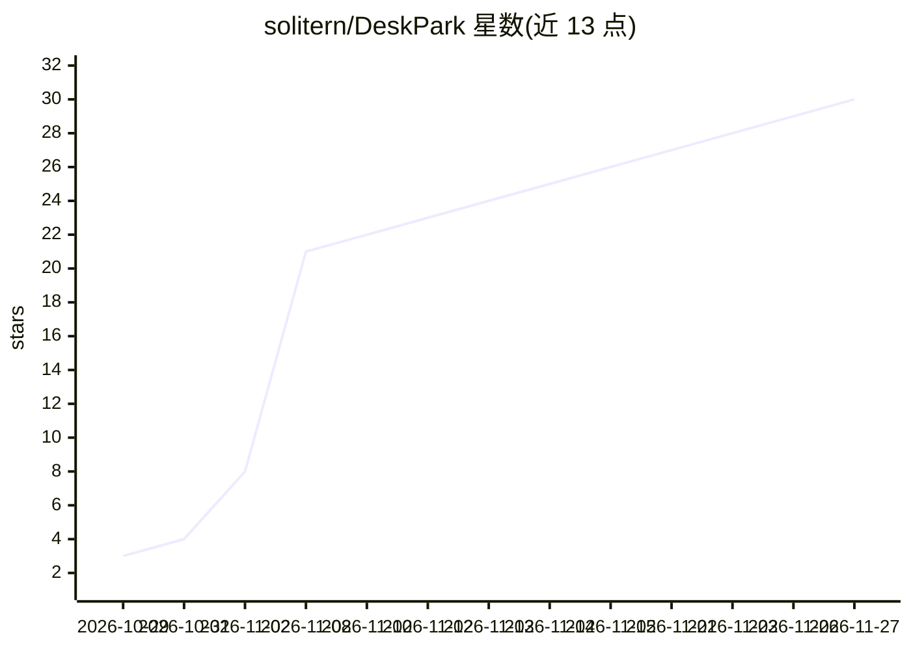

# solitern/DeskPark

⭐ 30 · TypeScript · MIT · 推送 2026-11-25 · [GitHub](https://github.com/solitern/DeskPark) · 个人维护 · 中文 README

**网页桌游平台：斗地主/掼蛋/麻将/棋牌，支持联机与 AI 托管**

浏览器即玩的桌游平台，覆盖斗地主、掼蛋、德州扑克、四川麻将（血战到底）、中国象棋、国际象棋及多款桌游，支持单人人机与房间号/链接联机、房间聊天、像素虚拟形象。规则引擎与界面分离（纯 TypeScript，无 DOM），所有玩法实现统一 GameDefinition 插件接口可扩展。AI 相关：麻将与棋类导师（本机计算，可配大模型讲解）、棋类用浏览器内 Stockfish/Fairy-Stockfish 引擎、大模型可接管电脑玩家（Anthropic 或任意 OpenAI 兼容接口如 DeepSeek）。需 Node.js ≥ 20，提供 npm 运行与 Docker 镜像（amd64/arm64）部署，服务端权威防作弊。

## 筛选速览

| 维度 | 判定 | 备注 |
|---|---|---|
| AI 角色 | `ai-enhanced` | 去掉 AI 部分产品仍成立 |
| 许可风险 | `permissive` | MIT |
| 部署形态 | `self-host` | docker 或自建部署 |
| 模型依赖 | — | README 未给出锁定关系 |
| 硬件要求 | — | 无带数字的原话,不猜 |
| 安装摩擦 | `low` | 无编译、无系统依赖或容器化 |
| 成熟度 | — | 结构信号不足 |

## 能力要点

- 多玩法规则引擎与界面分离，GameDefinition 插件接口可扩展自定义玩法
- 麻将/棋类导师：本机计算讲解，可选大模型大白话讲解与追问
- 配置 OpenAI 兼容接口（DeepSeek/通义千问/Anthropic）让大模型接管电脑玩家
- Docker 一键部署，镜像支持 amd64/arm64，自动构建与冒烟测试

## 适用场景

- 和好友通过房间号或链接联机打牌、下棋
- 单人练习并用导师功能学习麻将/棋类决策
- 自建部署一个桌游平台供小圈子游玩

## 场景标签

 · 领域:游戏/网页应用

## 证据(README 行号)

> L3: **简洁优雅的网页桌游平台** —— 斗地主、掼蛋、德州扑克、四川麻将（血战到底）、中国象棋、国际象棋、桌游「魔法出包」「UON」「卡旦岛」「宝石商会」，单人练习或与好友联机。
> L18: - **AI 人机**：在设置里填写自己的大模型接口（Anthropic 或任意 OpenAI 兼容接口，如 DeepSeek、通义千问），点电脑玩家头像上方的 ✨ 即可让大模型接管它：读取它的手牌与场上局势来决定出牌，思考时显示
> L20: - **单人 & 多人**：单人与电脑对战（规则 AI，德州使用蒙特卡洛胜率估算；也可唤醒大模型接管）；联机输入 4 位房间号或分享链接即可加入，空位由电脑补齐。

## 星数曲线

2026-10-29 3 → 2026-11-27 30（+27）

---
*卡片 v1 · prompt 1.4 · 生成 2026-11-18 · 置信度 high · 依据 README sha `ddc9a11f15c7` · [字段定义](../../DATASET.md)*
