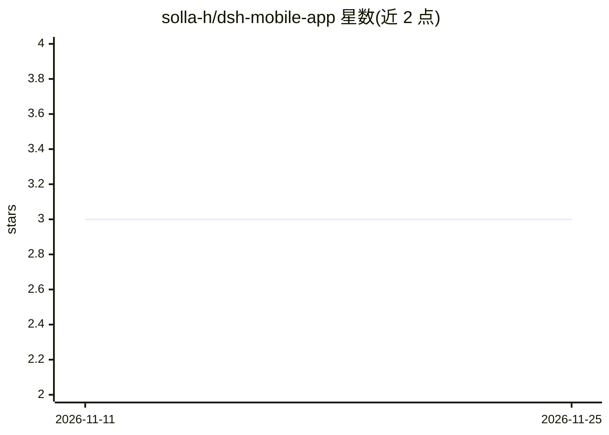

# solla-h/dsh-mobile-app

⭐ 3 · TypeScript · MIT · 推送 2026-11-22 · [GitHub](https://github.com/solla-h/dsh-mobile-app) · [官网](https://fatwhale.app) · 个人维护 · 中文 README

**DeepSeek Harness 的 Android 客户端：手机查看与继续 agent 会话**

第三方开源的 DeepSeek Harness（DSH）Android 客户端，用于连接用户自建的 DSH 宿主：查看运行中的 agent 会话、处理审批与提问、发送文字/图片/文件/语音消息。支持扫码配对、多网关切换、本地缓存与离线发件箱补发、公网 wss 加密入口。要求宿主运行固定版本组合（DSH 0.2.1-rc.5 + 网关 0.12.0-rdv.3），不自带模型、不托管服务；iOS 暂缓，目前以侧载 APK 分发，处于公开 alpha 阶段。

## 筛选速览

| 维度 | 判定 | 备注 |
|---|---|---|
| AI 角色 | `ai-ecosystem` | LLM/agent 周边工具 |
| 许可风险 | `permissive` | MIT |
| 部署形态 | `library` | 以包/库形式分发 |
| 模型依赖 | — | README 未给出锁定关系 |
| 硬件要求 | — | 无带数字的原话,不猜 |
| 安装摩擦 | `medium` | 含编译或系统依赖之一 |
| 成熟度 | `idea` | |

## 能力要点

- 扫码配对自建 DSH 宿主，多网关切换
- 会话内流式回复、思考/工具轨迹、审批卡与语音输入
- 本地缓存、离线发件箱按序补发、rendezvous-v1 地址簿找回入口
- 中英文双界面，公网入口强制 wss 加密

## 适用场景

- 在手机上盯 agent 运行进度并处理审批
- 离开电脑后继续与 agent 对话
- 自建 DSH 宿主的移动端管理入口

## 场景标签

`编码 Agent` `AI 助手` · 领域:编码与开发

## 证据(README 行号)

> L9: **DSH Mobile App（大肥鱼 / FatWhale）是第三方、开源的 DeepSeek Harness（DSH）Android 客户端——在手机上查看 DSH 进度、处理审批、继续对话。**
> L12: DSH Mobile App 连接你自己运行的 DSH 宿主。Agent 在宿主上执行，手机让你随时看清「什么在跑、什么在等我、我接下来要说什么」。
> L76: DSH Mobile 不自带模型，也不托管 DSH 服务。你需要一台运行 **DSH Web** 的机器，并在对应 profile 里安装

## 星数曲线

2026-11-11 3 → 2026-11-25 3（+0）

---
*卡片 v1 · prompt 1.4 · 生成 2026-11-21 · 置信度 mid · 依据 README sha `4f621360a0c1` · [字段定义](../../DATASET.md)*
