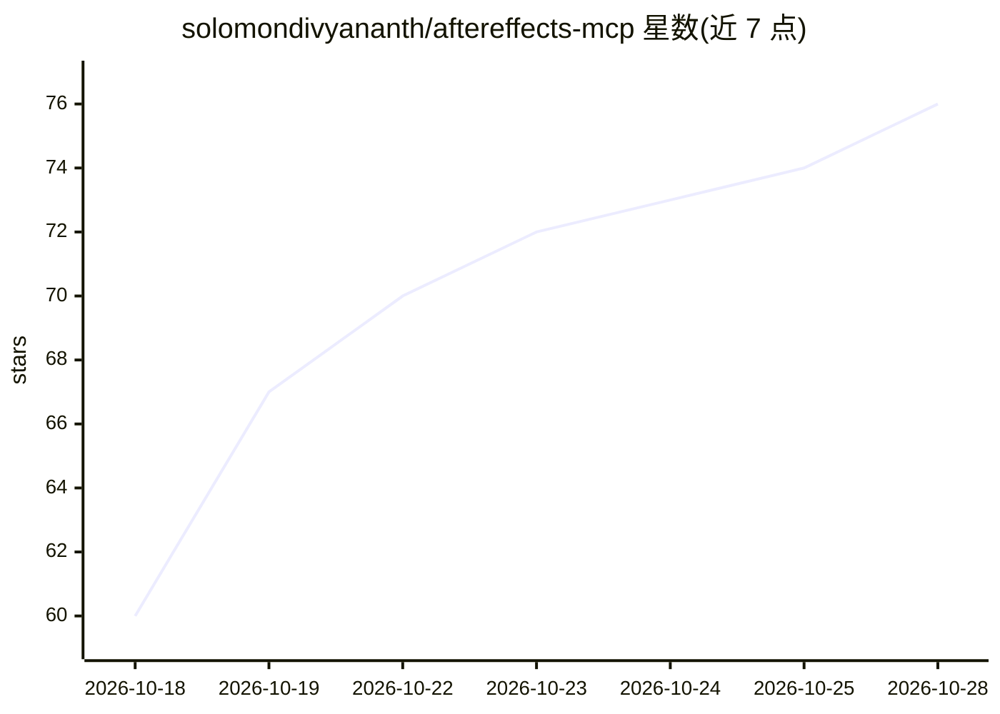

# solomondivyananth/aftereffects-mcp

⭐ 77 · JavaScript · MIT · 推送 2026-10-05 · [GitHub](https://github.com/solomondivyananth/aftereffects-mcp) · [官网](https://solomondivyananth.github.io/aftereffects-mcp/) · 个人维护

**让 AI agent 实时读写 Adobe After Effects 工程的 MCP 服务器**

通过 stdio 与 HTTP:7788 连接 MCP 客户端与 AE 内 CEP 面板的桥接服务器，提供 50 个工具：读取合成/图层/属性树、渲染帧并以图像返回、写关键帧与表达式、创建合成与工程、渲染视频，以及批量操作。每次调用包裹在单一撤销组内。附带 22 个技能与可由 AI 填充的动画模板。内置沙箱守卫（写入仅限指定工程）、原始脚本开关与仅回环+令牌的网络防护。要求 After Effects 2022+、Node.js 18+，macOS/Windows 可用，MIT 许可。

## 筛选速览

| 维度 | 判定 | 备注 |
|---|---|---|
| AI 角色 | `ai-ecosystem` | LLM/agent 周边工具 |
| 许可风险 | `permissive` | MIT |
| 部署形态 | `library` | 以包/库形式分发 |
| 模型依赖 | — | README 未给出锁定关系 |
| 硬件要求 | — | 无带数字的原话,不猜 |
| 安装摩擦 | `low` | 无编译、无系统依赖或容器化 |
| 成熟度 | — | 结构信号不足 |

## 能力要点

- 50 个工具覆盖读取、渲染帧、关键帧/表达式编辑与渲染队列
- 沙箱守卫：写入仅限人工指定的沙箱工程，项目级操作默认拒绝
- 仅回环绑定 + 256 位令牌 + 拒绝带 Origin/Referer 请求的网络防护
- 22 个技能与带类型槽位的 JSON 动画模板（多种宽高比、失败回滚）

## 适用场景

- 让 AI agent 审计并批量修改他人搭建的 AE 合成
- 从成品主合成生成 9:16/1:1/16:9 多格式变体
- 用自然语言备注让工具生成关键帧调整计划再由 agent 执行

## 场景标签

 · 领域:创意软件自动化/动效

## 证据(README 行号)

> L15: MCP client ──stdio──► mcp/ae-mcp.js ──HTTP :7788──► CEP panel in AE ──evalScript──► AE DOM
> L18: Works with Claude Code or any client that

## 星数曲线

2026-10-18 60 → 2026-10-28 76（+16）

---
*卡片 v1 · prompt 1.4 · 生成 2026-10-24 · 置信度 high · 依据 README sha `e2bf85485d58` · [字段定义](../../DATASET.md)*
