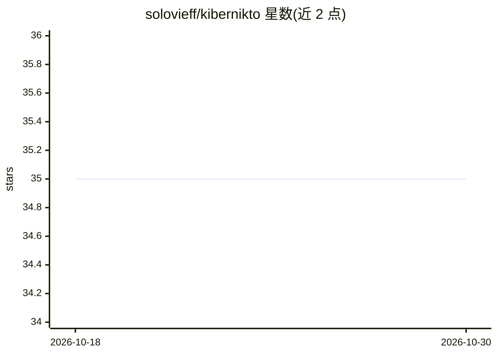

# solovieff/kibernikto

⭐ 35 · Python · GPL-3.0 · 推送 2026-10-24 · [GitHub](https://github.com/solovieff/kibernikto) · [官网](https://telegram.me/cybernoone_bot) · 个人维护

**接入 Telegram 的多 agent AI 框架**

提供多 LLM agent 编排框架与开箱即用的 aiogram Telegram bot 集成：可在群组/私聊中对话，支持语音识别、图像识别、Telegram star 支付集成与消息日志。核心部分为可自定义的 LLM executor（基于 OpenAI 兼容接口，可换 URL 接不同 provider），支持组合多个 KiberniktoAgent 实例编排行为与工具调用，并附 planner/brave search 等示例。pip 安装，通过环境变量配置运行。

## 筛选速览

| 维度 | 判定 | 备注 |
|---|---|---|
| AI 角色 | `ai-ecosystem` | LLM/agent 周边工具 |
| 许可风险 | `viral` | GPL-3.0 |
| 部署形态 | `library` | 以包/库形式分发 |
| 模型依赖 | — | README 未给出锁定关系 |
| 硬件要求 | — | 无带数字的原话,不猜 |
| 安装摩擦 | `low` | 无编译、无系统依赖或容器化 |
| 成熟度 | — | 结构信号不足 |

## 能力要点

- 基于 aiogram 的 Telegram dispatcher 与消息处理器
- 多 LLM agent 编排与工具调用
- 语音识别、图像识别、star 支付集成、消息日志
- 可脱离 Telegram 作为库嵌入自有应用

## 适用场景

- 搭建带语音/图像识别的 Telegram AI 机器人
- 用多 agent 编排组合工具调用行为
- 将 agent 核心嵌入自己的应用

## 场景标签

`多智能体` `语音识别` · 领域:Agent 开发

## 证据(README 行号)

> L3: Kibernikto is a multi agent ai framework with a telegram bot connection.
> L20: - 🐫 multi LLM agent framework
> L64: You can use `OpenAIExecutor` directly to create any ai-connected bots.

## 星数曲线

2026-10-18 35 → 2026-10-30 35（+0）

---
*卡片 v1 · prompt 1.4 · 生成 2026-10-25 · 置信度 high · 依据 README sha `9b8e5c324c99` · [字段定义](../../DATASET.md)*
