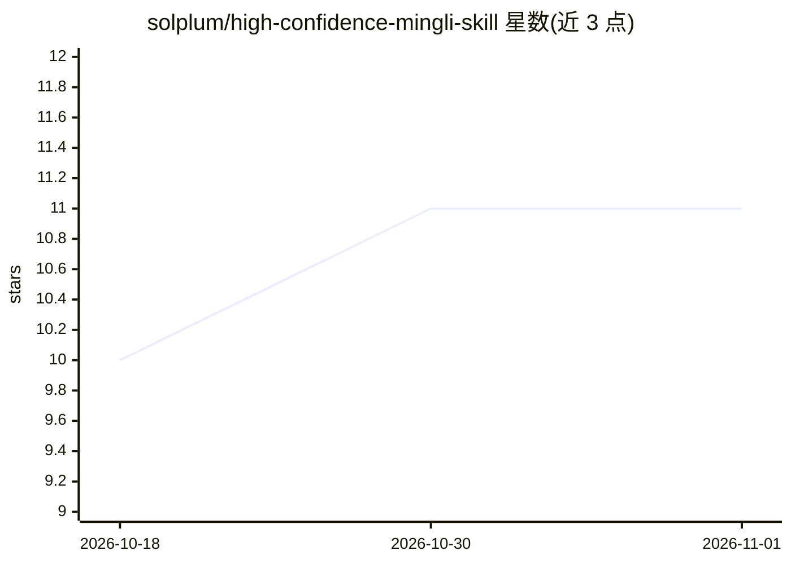

# solplum/high-confidence-mingli-skill

⭐ 11 · Python · MIT · 推送 2026-10-15 · [GitHub](https://github.com/solplum/high-confidence-mingli-skill) · 个人维护 · 中文 README

**装进 agent CLI 的命理解读技能：三盘互译+置信度门禁**

以 SKILL.md 形式装入 Claude Code / Codex / Kimi Code 等 agent CLI 的命理分析技能：八字（Meeus 定气）、紫微（iztro）、七政四余（自研恒星制）三套确定性引擎负责排盘，大模型只做解读；论断逐条挂典籍出处，三盘结论一致才标 ⭐ 置信度。建档时用历史事件校准解释器参数，断语经斯多葛转写。数据全存本地不上传；七政月限/小限等内容不做，紫微引擎缺 Node.js 时自动降级。

## 筛选速览

| 维度 | 判定 | 备注 |
|---|---|---|
| AI 角色 | `ai-native` | 本体是模型或模型工具 |
| 许可风险 | `permissive` | MIT |
| 部署形态 | `library` | 以包/库形式分发 |
| 模型依赖 | — | README 未给出锁定关系 |
| 硬件要求 | — | 无带数字的原话,不猜 |
| 安装摩擦 | `low` | 无编译、无系统依赖或容器化 |
| 成熟度 | — | 结构信号不足 |

## 能力要点

- 三套确定性排盘引擎（Meeus 八字/iztro 紫微/自研恒星制七政），LLM 不参与计算
- 论断逐条挂典籍出处，引文原样保留
- 三盘结论一致才标 ⭐ 置信度，单盘论断不标星
- 建档历史事件校准闭环，数据仅存本地

## 适用场景

- 在 agent CLI 里通过 /fortune-telling 命令做八字/紫微/七政命理分析
- 获取每条论断可回溯典籍原文的命理解读
- 需要离线、数据不出本地的命理工具

## 场景标签

 · 领域:传统命理/文化娱乐

## 证据(README 行号)

> L20: 一个装进 agent CLI（Claude Code / Codex / Kimi Code 等任何读 SKILL.md 的环境）的
> L27: |🔢|**确定性排盘引擎**|四柱/安星/躔度全部由三套引擎计算（Meeus 定气八字 / iztro 紫微 / 自研恒星制七政），27 项回归测试盯着，大模型只负责解读，不负责算数|

## 星数曲线

2026-10-18 10 → 2026-11-01 11（+1）

---
*卡片 v1 · prompt 1.4 · 生成 2026-11-01 · 置信度 mid · 依据 README sha `9fa791aa6080` · [字段定义](../../DATASET.md)*
