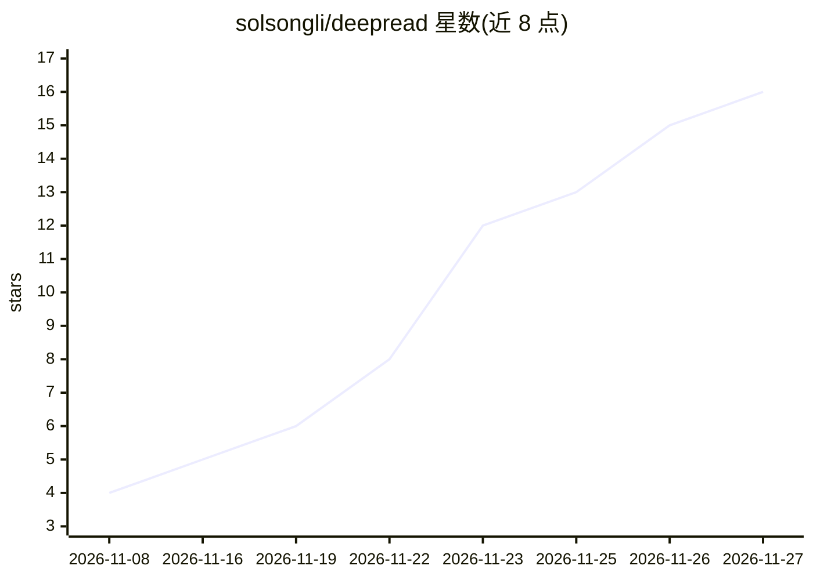

# solsongli/deepread

⭐ 16 · JavaScript · AGPL-3.0 · 推送 2026-11-25 · [GitHub](https://github.com/solsongli/deepread) · [官网](https://github.com/Lsy-aia/deepread/releases/latest) · 个人维护 · 中文 README

**Zotero AI 精读插件：逐段讲解、翻译、闪卡与对话**

DeepRead 是安装到 Zotero 7–10 官方客户端的开源插件，为 PDF 论文提供 AI 精读能力：解析 PDF 结构并逐段对齐后，调用用户自配的大模型 API 生成段落摘要、讲解、译文、图表读图步骤、速读卡与阅读问题，回答引用原文段落位置。支持明暗主题、本地 SQLite 存储精读结果，PDF 解析可选内置文字层、GROBID、MinerU API，不带账号与订阅，使用用户自己的 API Key。

## 筛选速览

| 维度 | 判定 | 备注 |
|---|---|---|
| AI 角色 | `ai-enhanced` | 去掉 AI 部分产品仍成立 |
| 许可风险 | `viral` | AGPL-3.0 |
| 部署形态 | `library` | 以包/库形式分发 |
| 模型依赖 | local-ok | 支持本地模型 |
| 硬件要求 | — | 无带数字的原话,不猜 |
| 安装摩擦 | `low` | 无编译、无系统依赖或容器化 |
| 成熟度 | — | 结构信号不足 |

## 能力要点

- 逐段 AI 讲解与页边卡片，标注段落角色并支持核对原文定位
- 悬停翻译保留原文双栏/单栏排版结构
- 基于全文的 AI 对话回答引用段落块如 (p. 3 ¶2)
- 可接入本地 Codex / Claude Code 或远程 API 生成五步带读

## 适用场景

- 在 Zotero 里精读论文时获得每段讲解与译文
- 阅读外文论文时悬停查看保留排版的中文翻译
- 通过 AI 对话提问并跳转到原文依据段落
- 用本地 Codex 或 Claude Code 让 Agent 带读论文

## 场景标签

`文档问答` `文档解析` · 领域:知识与检索

## 证据(README 行号)

> L1: # DeepRead：Zotero AI 精读插件
> L3: DeepRead 是一个免费、开源、独立维护的 Zotero AI 阅读插件，支持 Zotero 7–10，可直接安装到官方 Zotero。它提供段落讲解、保留原文结构的翻译、图表证据笔记、阅读问题与原文定位：
> L94: - **内置文字层（推荐）**：直接用 PDF 自带的文字层识别段落、标题、图表和公式。不需要任何服务，免费、离线、一篇论文约 1 秒。扫描版 PDF 没有文字层，无法使用精读功能。

## 星数曲线

2026-11-08 4 → 2026-11-27 16（+12）

---
*卡片 v1 · prompt 1.4 · 生成 2026-11-20 · 置信度 high · 依据 README sha `fc9c3e49364a` · [字段定义](../../DATASET.md)*
