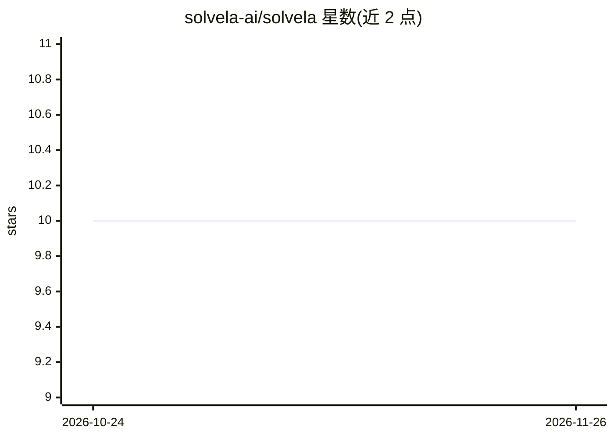

# solvela-ai/solvela

⭐ 10 · Rust · NOASSERTION · 推送 2026-11-25 · [GitHub](https://github.com/solvela-ai/solvela) · [官网](https://solvela.ai) · 组织维护

**面向 AI agent 的 Solana 链上 USDC 支付型 LLM API 网关**

以 Rust 编写的 LLM API 网关：客户端通过 x402 协议以 USDC-SPL 在 Solana 链上按请求付费，网关在链上验证支付（ed25519 签名、ATA 推导、Redis 防重放）后代理到上游提供商。内置 15 维规则打分器将请求分为四档复杂度并路由到对应模型，支持 eco/auto/premium/free 等路由档位。提供 Python/TypeScript/Go SDK、CLI、MCP server 及 Vercel AI SDK 提供商包。运行需 Rust、Docker（PostgreSQL+Redis）与至少一个提供商 API key。

## 筛选速览

| 维度 | 判定 | 备注 |
|---|---|---|
| AI 角色 | `ai-ecosystem` | LLM/agent 周边工具 |
| 许可风险 | `none` | NOASSERTION |
| 部署形态 | `self-host` | docker 或自建部署 |
| 模型依赖 | locked-api |  |
| 硬件要求 | — | 无带数字的原话,不猜 |
| 安装摩擦 | `low` | 无编译、无系统依赖或容器化 |
| 成熟度 | — | 结构信号不足 |

## 能力要点

- x402 协议的 USDC-SPL 链上支付验证，支持直付与 Anchor 托管（escrow）两种方案
- 15 维规则打分器做复杂度分级与模型路由，评分无外部调用
- 适配 OpenAI/Anthropic/Google/xAI/DeepSeek/NVIDIA NIM 的提供商转换层，按提供商熔断与自动回退
- Python/TypeScript/Go SDK 与 MCP server（Claude Code、Cursor、Claude Desktop、OpenClaw）一键安装

## 适用场景

- 为 AI agent 提供按请求的链上 USDC 付费的 LLM API 访问
- 通过路由档位在不同成本/能力的模型间分配请求
- 通过 MCP 将钱包与付费对话接入 Claude Code/Cursor 等客户端

## 场景标签

`模型网关` · 领域:Agent 开发

## 证据(README 行号)

> L13: AI agents pay for LLM API calls with USDC-SPL on Solana via the x402 protocol. The gateway verifies payments on-cha
> L36: OpenAI, Anthropic, Google, xAI, DeepSeek, and NVIDIA NIM (a free Nemotron tier plus paid models). Provider adapters
> L179: |`POST`|`/v1/chat/completions`|OpenAI-compatible chat (x402 paid)|

## 星数曲线

2026-10-24 10 → 2026-11-26 10（+0）

---
*卡片 v1 · prompt 1.4 · 生成 2026-11-19 · 置信度 high · 依据 README sha `f075b0a40ebe` · [字段定义](../../DATASET.md)*
