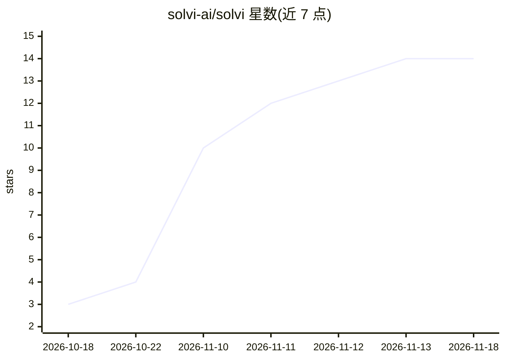

# solvi-ai/solvi

⭐ 14 · Python · Apache-2.0 · 推送 2026-11-07 · [GitHub](https://github.com/solvi-ai/solvi) · [官网](https://solvi-ai.github.io/solvi/) · 组织维护

**面向开发者的可校验决策系统框架：模型提议、代码裁决**

以 Python 函数与硬检查描述决策逻辑，模型（LLM、自有分类器或本地小模型）仅负责提议，最终由检查规则裁决；每个答案带置信度、可核验理由（规则输入、事实公式或原文引语及字符偏移）与可重放的哈希链 trace，无法计算或校验时弃权或转人工。提供 solvi.document（文档决策）、solvi.build（从标注样本构建带错误保证的决策）、solvi.Agent、solvi.Guard（工具调用守卫）等就绪系统，以及可替换的 solvi.core 构建块。决策模型支持任意 OpenAI 兼容服务（OpenRouter、vLLM、llama.cpp、Ollama）、System One API 及本地 ONNX checkpoint（CPU，无需 GPU）。需 Python 3.11+。

## 筛选速览

| 维度 | 判定 | 备注 |
|---|---|---|
| AI 角色 | `ai-ecosystem` | LLM/agent 周边工具 |
| 许可风险 | `permissive` | Apache-2.0 |
| 部署形态 | `library` | 以包/库形式分发 |
| 模型依赖 | local-ok | 支持本地模型 |
| 硬件要求 | `cpu-ok` | |
| 安装摩擦 | `low` | 无编译、无系统依赖或容器化 |
| 成熟度 | `idea` | |

## 能力要点

- 模型提议、代码硬检查裁决，硬检查失败覆盖任何模型置信度
- 答案附可核验理由与哈希链 trace，可重放定位被改动步骤
- solvi.document 按字段给出带原文引语的弃权/回答，校准弃权阈值
- solvi.Guard 校验 agent 工具调用：目录、类型、对话引语与策略均为硬检查

## 适用场景

- 在发票、合同、收据等文档上构建可审计的字段级决策
- 为 agent 的工具调用加策略守卫并保留可重放 trace
- 从少量标注样本构建带错误保证、可转人工的决策系统

## 场景标签

`Agent 框架` · 领域:Agent 开发

## 证据(README 行号)

> L3: Decision systems you can check. You describe what to compute with plain Python functions and checks; a model — an LL
> L4: your own classifier or a small local one — proposes where judgement is needed; solvi's checks decide. Every answer
> L141: Types declare questions; a model proposes; checks decide. The fields of a pydantic model are the questions, their 

## 星数曲线

2026-10-18 3 → 2026-11-18 14（+11）

---
*卡片 v1 · prompt 1.4 · 生成 2026-11-18 · 置信度 high · 依据 README sha `913fc050b45f` · [字段定义](../../DATASET.md)*
