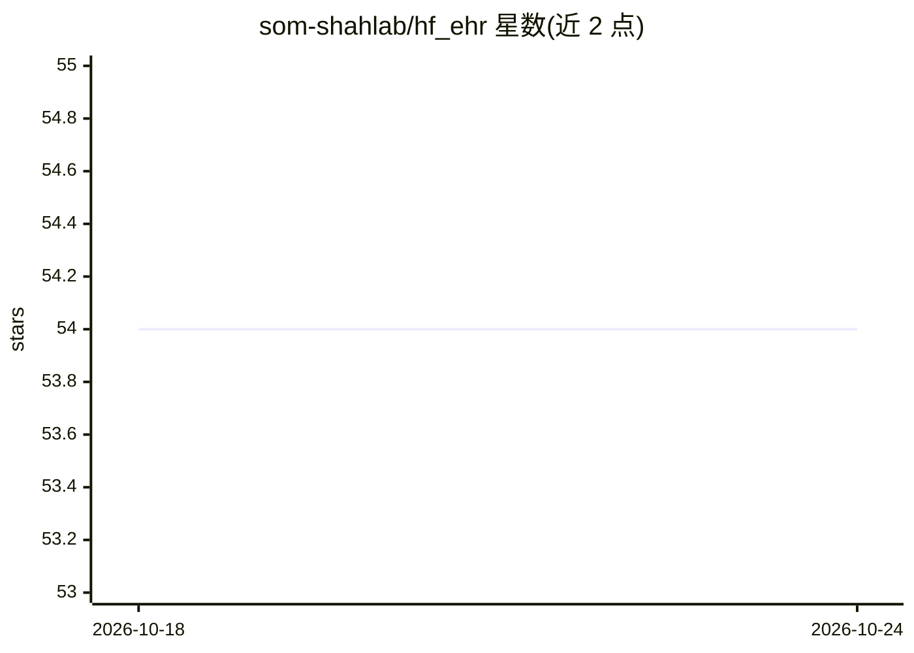

# som-shahlab/hf_ehr

⭐ 54 · Jupyter Notebook · Apache-2.0 · 推送 2025-11-02 · [GitHub](https://github.com/som-shahlab/hf_ehr) · [官网](https://arxiv.org/abs/2412.16178) · 组织维护

**在结构化 EHR 数据上训练 HuggingFace 模型的代码库与预训练模型**

配套 Context Clues 论文的代码库，支持在 MEDS 标准或 FEMR 格式的结构化电子健康记录数据上训练任意 HuggingFace 架构（GPT、BERT、Llama、Mamba、Hyena），内置 Hydra 配置、Wandb 日志与 PyTorch Lightning 分布式训练，支持 SLURM 多节点并行。另发布在 20 亿 token 去标识 EHR 数据上从零预训练的模型（可经 transformers 直接加载），并演示用 MIMIC-IV demo 与 Merative MarketScan 数据集完成数据转换、tokenizer 训练到模型训练的完整流程，支持 EHRSHOT 基准评测。

## 筛选速览

| 维度 | 判定 | 备注 |
|---|---|---|
| AI 角色 | `ai-ecosystem` | LLM/agent 周边工具 |
| 许可风险 | `permissive` | Apache-2.0 |
| 部署形态 | `library` | 以包/库形式分发 |
| 模型依赖 | — | README 未给出锁定关系 |
| 硬件要求 | — | 无带数字的原话,不猜 |
| 安装摩擦 | `low` | 无编译、无系统依赖或容器化 |
| 成熟度 | — | 结构信号不足 |

## 能力要点

- 支持 GPT/BERT/Llama/Mamba/Hyena 架构在 EHR 数据上训练，上下文长度最高 16384
- 提供 20 亿 token 去标识 EHR 数据预训练的 HuggingFace 模型，可直接加载
- Hydra 配置 + Wandb 日志 + PyTorch Lightning 分布式训练 + SLURM 并行脚本
- 提供 MIMIC-IV demo（MEDS 格式）与 Truven/MarketScan（OMOP CDMv5）端到端示例

## 适用场景

- 在院内 EHR 数据上训练临床语言基础模型
- 用预训练模型生成患者表征并在 EHRSHOT 基准上评测
- 复现或扩展 Context Clues 论文实验

## 场景标签

`模型训练` `模型评测` · 领域:评测与运维

## 证据(README 行号)

> L3: This repo contains code and pretrained models for the **Context Clues paper**. It is designed to enable **training a
> L105: We use Hydra to manage our configurations and PyTorch Lightning for training.

## 星数曲线

2026-10-18 54 → 2026-10-24 54（+0）

---
*卡片 v1 · prompt 1.4 · 生成 2026-10-24 · 置信度 high · 依据 README sha `3614f793843e` · [字段定义](../../DATASET.md)*
